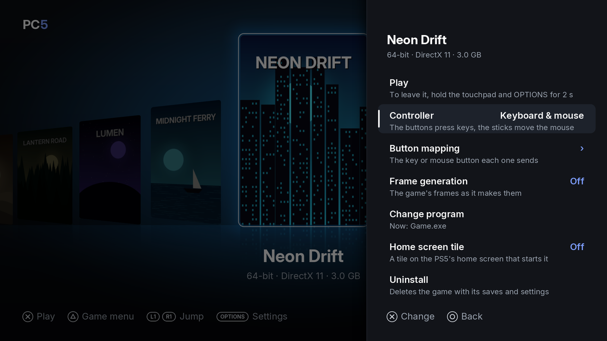
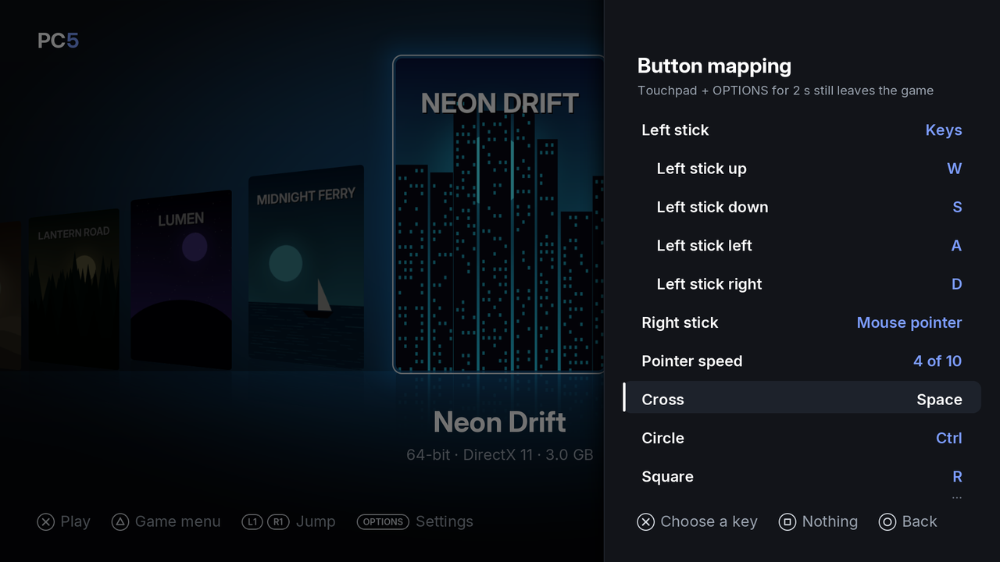
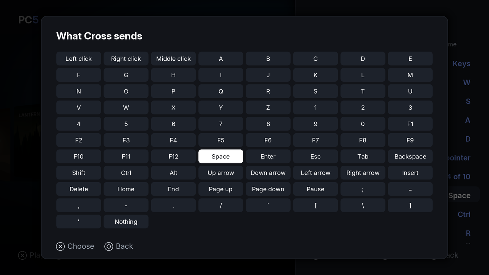

PC5 lets each game see your controller in one of three ways: as an Xbox controller, as a DualSense plugged into a PC, or as a keyboard and mouse with a button mapping you choose. The choice is made in the game's menu and kept for that game. This page explains the three modes, the button mapping, leaving a game, and answering a game's Windows pop-ups.

## Choosing a controller mode

1. In the library, choose the game and press **△**.
2. Choose **Controller** and press **✕** (or left / right) until it shows the mode you want.
3. Start the game. The change takes effect the next time the game starts.

| Mode | The game sees | Use it for |
| --- | --- | --- |
| Xbox controller | An Xbox controller (XInput). **The default.** | Most games from the last twenty years, which look for an Xbox controller. Games that read controllers through Windows.Gaming.Input find it too. |
| DualSense | A DualSense plugged in by USB, as on a PC. The game gets the touchpad and the motion sensors, and its own rumble, light bar and adaptive trigger effects reach the controller. | Games that know the DualSense, or look for controllers another way (DirectInput, raw input, SDL). |
| Keyboard & mouse | A keyboard and a mouse. Each button and stick direction sends the key or mouse button you choose in **Button mapping**. | Games without controller support. |

Which one to try: start with **Xbox controller**. If the game doesn't react to the controller, try **DualSense**. If the game has no controller support at all, use **Keyboard & mouse**.

A USB keyboard and mouse plugged into the PS5 work in every mode, alongside the controller.

## Keyboard & mouse

With **Keyboard & mouse**, the game menu gets a **Button mapping** row.

*Keyboard & mouse adds the Button mapping row to the game's menu.*

### Button mapping

1. Choose the game, press **△**, and set **Controller** to **Keyboard & mouse**.
2. Choose **Button mapping** and press **✕**.
3. Choose a button or a stick direction and press **✕**. The key picker opens.
4. Choose a key, a mouse button or **Nothing**, and press **✕**.
5. Press **○** to go back. Each change is saved at once and applies the next time the game starts.

*Button mapping: what each stick and button sends.*

*The key picker: every key, mouse button and Nothing.*

| Button | On the Button mapping screen |
| --- | --- |
| ✕ | Choose a key for the button or direction (or change a stick's use, the pointer speed, or reset) |
| Left / right | Step through the values without opening the key picker |
| □ | Set the button or direction to **Nothing** |
| ○ | Back to the game's menu |

The key picker has the letters A to Z, the digits 0 to 9, F1 to F12, Space, Enter, Esc, Tab, Backspace, Shift, Ctrl, Alt, the four arrows, Insert, Delete, Home, End, Page up, Page down, Pause, the punctuation keys `` ; = , - . / ` [ \ ] ' ``, left, right and middle click, and Nothing.

### The sticks

Each stick can be:

| Use | What it does |
| --- | --- |
| Keys | Sends four keys, one for each direction. The four directions then appear below the stick, each with its own key. A diagonal sends both. |
| Mouse pointer | Moves the mouse pointer. Only one stick can be the pointer: choosing it for one stick sets the other to Keys. |
| Nothing | Does nothing. |

While a stick is the pointer, **Pointer speed** sets how fast it moves, from 1 to 10 (4 by default).

### The default layout

**Reset to default**, at the bottom of the list, brings back this layout:

| Control | Sends |
| --- | --- |
| Left stick | Keys: W (up), S (down), A (left), D (right) |
| Right stick | Mouse pointer, speed 4 of 10 (as Keys: the arrow keys) |
| ✕ Cross | Space |
| ○ Circle | Ctrl |
| □ Square | R |
| △ Triangle | E |
| L1 | Q |
| R1 | F |
| L2 | Right click |
| R2 | Left click |
| L3 (left stick press) | Shift |
| R3 (right stick press) | V |
| D-pad | Up, down, left and right arrows |
| Options | Esc |
| Create | Tab |
| Touchpad | Enter |

## DualSense

With **DualSense**, the game finds a DualSense as if it were plugged into a PC by USB. Games that support the DualSense show PlayStation buttons, and get:

- the touchpad and the motion sensors;
- their own rumble, at the strength set in **Settings › In games › Vibration**;
- their own light bar colour and adaptive trigger effects, from the moment the game sets them. Until then, PC5's **Light bar** and **Adaptive triggers** settings apply.

## Rumble, light bar and adaptive triggers

The strength of a game's rumble, the light bar and the adaptive triggers follow **Settings › In games**, whichever mode is chosen. See [Settings](Settings#in-games).

## Leaving a game

Hold the **touchpad** and **Options** together for **two seconds**, whichever mode is chosen. The controller gives a short buzz, the game is asked to close (it can save), and if it hasn't closed after five seconds it is ended. You are back in PC5, or on the home screen if you started the game from its [home screen tile](Home-screen-tiles).

This combo always leaves the game. Don't use it to close a pop-up.

## A game's Windows pop-ups

Some games show a Windows box before they start, such as a warning about the computer's specs or a Yes / No question. With **Xbox controller** or **DualSense**:

| Button | In a Windows box |
| --- | --- |
| ✕ | Presses the highlighted button (OK, Yes) |
| D-pad | Moves between the buttons |

The game only gets these as keys while such a box is in front, so they don't get in the way while you play.

With **Keyboard & mouse**, the buttons send the keys they are mapped to, as always. With the default layout, **✕** is Space (which presses the highlighted button), the D-pad sends the arrow keys and the touchpad sends Enter.

## Changing the mode while a game runs

That isn't possible: the game picks up its controller when it starts. Leave the game, change the mode in its menu, and start it again.
