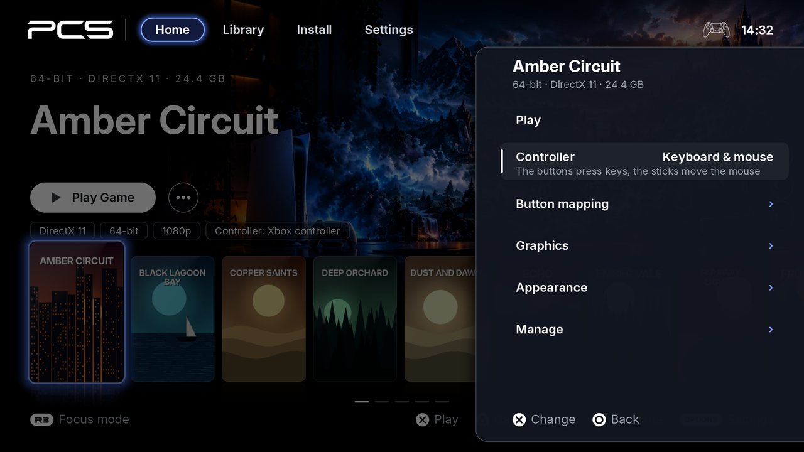
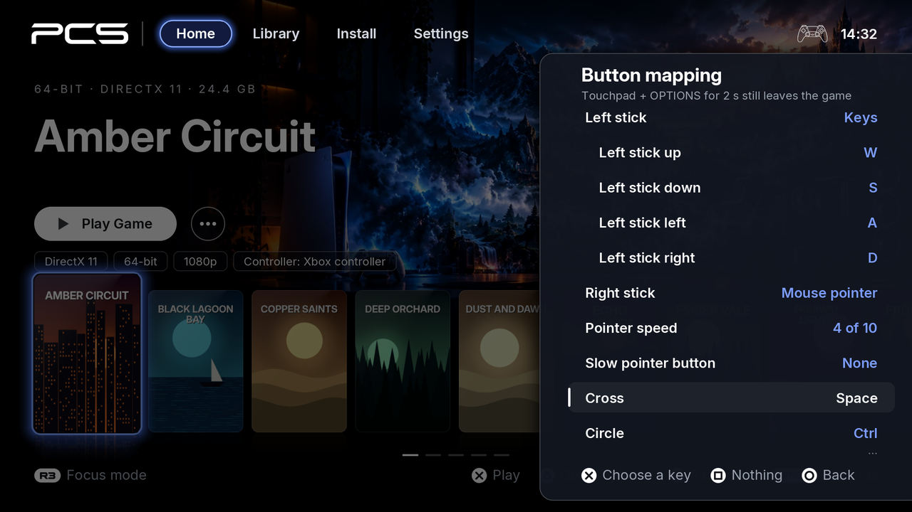
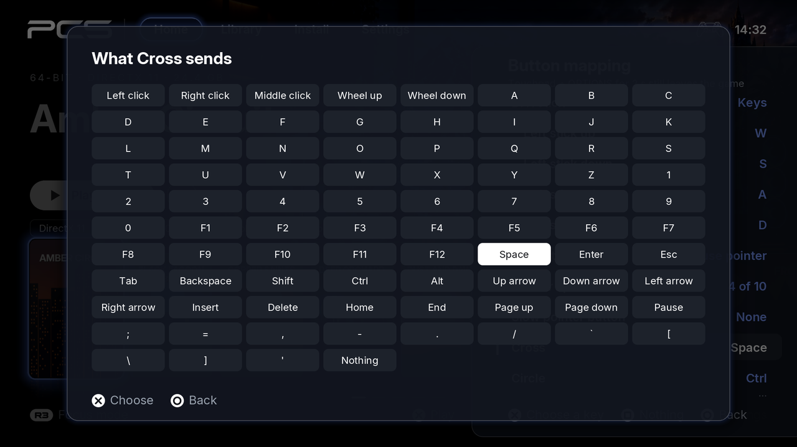

PC5 lets each game see your controller in one of four ways: as an Xbox controller, as a DualSense plugged into a PC, as a Logitech G29 steering wheel, or as a keyboard and mouse with a button mapping you choose. The choice is made in the game's menu and kept for that game. This page explains the four modes, the button mapping, playing with more than one player, leaving a game, and answering a game's Windows pop-ups.

## Choosing a controller mode

1. In the library, choose the game and press **△**.
2. Choose **Controller** and press **✕** (or left / right) until it shows the mode you want.
3. Start the game. The change takes effect the next time the game starts.

| Mode | The game sees | Use it for |
| --- | --- | --- |
| Xbox controller | An Xbox controller (XInput). **The default.** | Most games from the last twenty years, which look for an Xbox controller. Games that read controllers through Windows.Gaming.Input, DirectInput or Windows' joystick API find it too, as Windows shows an Xbox 360 controller. |
| DualSense | A DualSense plugged in by USB, as on a PC. The game gets the touchpad and the motion sensors, and its own rumble, light bar and adaptive trigger effects reach the controller. | Games that know the DualSense, or look for controllers another way (DirectInput, raw input, SDL). |
| G29 wheel | A Logitech G29 Driving Force wheel plugged in by USB, as on a PC: steering, accelerator, brake and clutch, the D-pad and 24 buttons (from 2.2.5). Plug the G29 into the PS5 with its mode switch on **PS4** before starting the game. Without a wheel, the game gets the Xbox controller. No force feedback yet. | Racing games with wheel support. |
| Keyboard & mouse | A keyboard and a mouse. Each button and stick direction sends the key or mouse button you choose in **Button mapping**. | Games without controller support. |

Which one to try: start with **Xbox controller**. If the game doesn't react to the controller, try **DualSense**. If the game has no controller support at all, use **Keyboard & mouse**.

Older games that read controllers with DirectInput see the Xbox controller as Windows shows one: "Controller (XBOX 360 For Windows)", with both triggers on one axis (the left one up, the right one down), the D-pad as a hat and ten buttons. A mod that turns a game's DirectInput controls into XInput isn't needed for that from 1.6.5.

A USB keyboard and mouse plugged into the PS5 work in every mode, alongside the controller. The mouse wheel works too (from 2.0.2).

A USB keyboard types in the layout of PC5's language, which is the console's unless **Settings › System › Language** chooses another (from 2.1.0). On a French console, for example, an AZERTY keyboard types as it is marked, and **AltGr + à** types **@**. A Russian, Ukrainian or Greek keyboard switches to the US layout and back with **Alt + Shift**, as on Windows. **Settings › System › Keyboard layout › US** keeps it as a US keyboard for every game, as before 2.1.0. The keys the controller sends with **Keyboard & mouse** are the same in every layout.

**Mouse pointer**, in the game's menu (press **△**), says whether the mouse pointer stays on screen as the game shows it (**Normal**, the default) or hides when you haven't moved it or clicked for 5 seconds (**Auto-hide**). That's for a game played with the controller that leaves the pointer sitting in a corner. When it hides, moving it (a stick, the touchpad or a mouse) or clicking shows it again at once. It is set for each game on its own.

## Keyboard & mouse

With **Keyboard & mouse**, the game menu gets a **Button mapping** row.

*Keyboard & mouse adds the Button mapping row to the game's menu.*

### Button mapping

1. Choose the game, press **△**, and set **Controller** to **Keyboard & mouse**.
2. Choose **Button mapping** and press **✕**.
3. Choose a button or a stick direction and press **✕**. The key picker opens.
4. Choose a key, a mouse button or **Nothing**, and press **✕**.
5. Press **○** to go back. Each change is saved at once and applies the next time the game starts.

*Button mapping: what each stick and button sends.*

*The key picker: every key, mouse button and Nothing.*

| Button | On the Button mapping screen |
| --- | --- |
| ✕ | Choose a key for the button or direction (or change a stick's use, the pointer speed, or reset) |
| Left / right | Step through the values without opening the key picker |
| □ | Set the button or direction to **Nothing** |
| ○ | Back to the game's menu |

The key picker has the letters A to Z, the digits 0 to 9, F1 to F12, Space, Enter, Esc, Tab, Backspace, Shift, Ctrl, Alt, the four arrows, Insert, Delete, Home, End, Page up, Page down, Pause, the punctuation keys `` ; = , - . / ` [ \ ] ' ``, left, right and middle click, **Wheel up** and **Wheel down** (each press turns the mouse wheel one notch: a visual novel's rollback, a map's zoom), and Nothing.

### The sticks

Each stick can be:

| Use | What it does |
| --- | --- |
| Keys | Sends four keys, one for each direction. The four directions then appear below the stick, each with its own key. A diagonal sends both. |
| Mouse pointer | Moves the mouse pointer. Only one stick can be the pointer: choosing it for one stick sets the other to Keys. |
| Nothing | Does nothing. |

While a stick is the pointer, **Pointer speed** sets how fast it moves, from 1 to 10 (4 by default).

**Slow pointer button** picks a button that slows the pointer while you hold it, for placing and aiming precisely (None by default). **Slower by** sets how much, from 10 % to 90 % (50 % by default). While a button is the slow button it does only that: its row says **Slows the pointer**.

### The touchpad

From 2.2.0, the **Touchpad** row sets what the touchpad does:

| Touchpad | What it does |
| --- | --- |
| **One button** (the default) | A click anywhere sends one key: the **Click** row below it (Enter by default), as before 2.2.0. |
| **Halves and swipes** | A click on the **left half** and on the **right half** each send a key of their own (Enter and Esc by default), and a quick **swipe** up, down, left or right sends a key too (Nothing by default). A swipe is a slide across about a quarter of the touchpad, quickly: a slow slide or a short one does nothing. |
| **Mouse** | Sliding a finger moves the mouse pointer, like a laptop's touchpad. A click sends the **Click** row's key: set it to **Left click** to click with it. |

**Two-finger click** opens the PS5's on-screen keyboard (see [Typing in a game](#typing-in-a-game)) unless you choose a key for it: then a click with two fingers sends that key instead, for a game that needs one more key.

Holding the touchpad and **Options** for two seconds still leaves the game, whatever the touchpad does. **Save as my mapping** keeps the touchpad's rows with the rest.

### The default layout

**Reset to default**, at the bottom of the list, brings back this layout:

| Control | Sends |
| --- | --- |
| Left stick | Keys: W (up), S (down), A (left), D (right) |
| Right stick | Mouse pointer, speed 4 of 10 (as Keys: the arrow keys) |
| ✕ Cross | Space |
| ○ Circle | Ctrl |
| □ Square | R |
| △ Triangle | E |
| L1 | Q |
| R1 | F |
| L2 | Right click |
| R2 | Left click |
| L3 (left stick press) | Shift |
| R3 (right stick press) | V |
| D-pad | Up, down, left and right arrows |
| Options | Esc |
| Create | Tab |
| Touchpad | Enter |

## DualSense

With **DualSense**, the game finds a DualSense as if it were plugged into a PC by USB. Games that support the DualSense show PlayStation buttons, and get:

- the touchpad and the motion sensors;
- their own rumble, at the strength set in **Settings › In games › Vibration**;
- their own light bar colour and adaptive trigger effects, from the moment the game sets them. Until then, PC5's **Light bar** and **Adaptive triggers** settings apply.

## More than one player

Up to four players can play a game with local multiplayer (split screen, couch co-op), each with their own controller, in **Xbox controller** and **DualSense** mode. On the PS5 each controller belongs to a signed-in user, so each player signs in:

1. Turn on another controller and press its **PS** button.
2. Sign in with it as another user on the console, or as a guest.
3. Within a second the game finds that player's controller, while it runs. Players join in the order they sign in, and a player who signs out leaves: the next one to sign in takes their place.

- With **Xbox controller**, the game finds up to four Xbox controllers, each with its own rumble.
- With **DualSense**, player 1 is the DualSense, and players 2 to 4 are Xbox controllers.
- **Keyboard & mouse** is for one player.
- Player 1 is whoever started PC5. Only player 1's controller leaves the game, opens the on-screen keyboard and gets PC5's light bar and adaptive triggers. Everyone's rumble follows **Settings › In games › Vibration**.
- Which controller is which player, and whether a game has local multiplayer at all, is up to the game. Some games ask each player to press a button first.

## Rumble, light bar and adaptive triggers

The strength of a game's rumble, the light bar and the adaptive triggers follow **Settings › In games**, whichever mode is chosen. See [Settings](Settings#in-games).

A game's rumble plays on the controller's two motors, as on a PC. From PC5 1.9.4, PC5 sets each controller to the PS5's compatible vibration mode when the game starts; before that, on many consoles the motors stayed still while the adaptive triggers still played. If a game's rumble still doesn't reach the controller, check **Settings › Accessories › Controllers › Vibration Intensity** in the PS5's own settings, and [report it](Reporting-a-problem) with the game's log: its `PW_WINE64 rumble` line shows what the console answered.

## Leaving a game

Hold the **touchpad** and **Options** together for **two seconds**, whichever mode is chosen. The controller gives a short buzz, the game is asked to close (it can save), and if it hasn't closed after five seconds it is ended. You are back in PC5, or on the home screen if you started the game from its [home screen tile](Home-screen-tiles).

This combo always leaves the game. Don't use it to close a pop-up.

## Typing in a game

Click the **touchpad with two fingers** in a game, whichever mode is chosen, and the PS5's on-screen keyboard opens over the game (with Keyboard & mouse, unless **Button mapping › Two-finger click** has a key of its own). Type, then choose **Done**: the text is typed into the game, where its text box has the cursor (a name, a chat line, a server's address). **Cancel** closes the keyboard without typing anything.

- Put the cursor in the game's text box first, with the controller or the pointer.
- The game gets the text as characters typed on Windows. A game that reads the keyboard's keys rather than the characters typed doesn't see it.
- The two-finger click itself never reaches the game. A click with one finger reaches it as before.
- If the game needs Enter to accept the text, press the button that sends Enter, or ✕ in its menu.

## A game's Windows pop-ups

Some games show a Windows box before they start, such as a warning about the computer's specs or a Yes / No question. With **Xbox controller** or **DualSense**:

| Button | In a Windows box |
| --- | --- |
| ✕ | Presses the highlighted button (OK, Yes) |
| D-pad | Moves between the buttons |

The game only gets these as keys while such a box is in front, so they don't get in the way while you play.

With **Keyboard & mouse**, the buttons send the keys they are mapped to, as always. With the default layout, **✕** is Space (which presses the highlighted button), the D-pad sends the arrow keys and the touchpad sends Enter.

## Changing the mode while a game runs

That isn't possible: the game picks up its controller when it starts. Leave the game, change the mode in its menu, and start it again.
