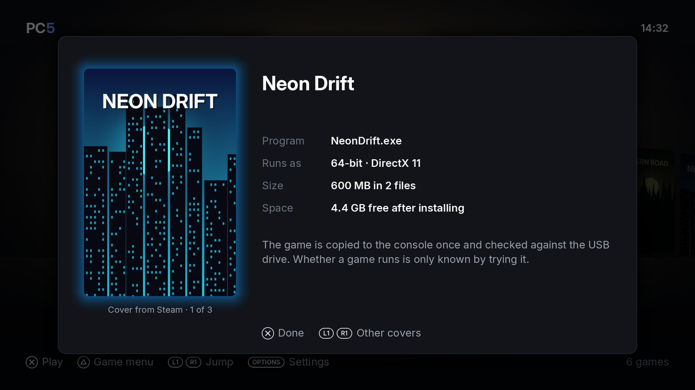

Every game in PC5 has a cover. PC5 looks for it online on public sources, with no account and no key, or uses a picture you give it. A game no source has gets a cover made from its own icon and name. This page explains where covers come from, how to choose one, and how to use your own.

## Where covers come from

PC5 looks in this order:

1. **Your own picture**, if you gave one (see [Using your own cover](#using-your-own-cover)).
2. **Steam's store.** If the game's folder has a `steam_appid.txt` at its top, PC5 uses that number to find the game's Steam cover directly.
3. **GOG's catalogue.**
4. **Wikipedia**: the lead picture of the game's article.
5. If none of them has the game: a **card made from the game's icon and name**.

To search, PC5 uses the program's product name, the folder's name (without release tags and version numbers) and the program's name. It only offers results whose name is close to the game's.

A source that doesn't answer is skipped. A game installed without internet gets your own picture or its card, and keeps it: to give it another cover later, use [your own picture](#for-a-game-already-installed).

## Choosing a cover when installing

The review screen shows the best cover PC5 found, where it comes from, and how many there are: for example "Cover from Steam · 1 of 3".

*The review screen. L1 / R1 go through the covers found; the last one is the card made from the game's icon.*

1. Press **L1** or **R1** to go through the covers found.
2. The last choice is always the card made from the game's icon and name.
3. Press **✕** to install with the cover shown.

When you install several games in a row, open a game's review screen from the list (**✕**) to change its cover.

## Using your own cover

Your picture can be a `.jpg`, `.jpeg` or `.png` file. PC5 cuts it to the cover's 2:3 portrait shape, so a 2:3 picture (for example 600 × 900 pixels) fits without being cut. Covers are kept at 480 × 720.

### When installing

Put `cover.jpg`, `cover.jpeg` or `cover.png` at the top of the game's folder on the USB drive. It is the first cover offered on the review screen, as "your picture".

### For a game already installed

1. On the console, make a folder `/data/prospero-win/covers/` if there isn't one.
2. Put your picture in it, named after one of these (upper or lower case doesn't matter):
   - the game's folder name, as it was on the USB drive;
   - the game's name in PC5;
   - the game's id (the name of its folder in `/data/prospero-win/prefixes/`).

   For example: `/data/prospero-win/covers/Neon Drift.png`.
3. Open PC5 (or close it and open it again). The picture becomes the game's cover.

PC5 uses your picture in place of anything online. If you replace the file later, PC5 uses the new picture the next time it opens. PC5 goes by the file's date: the picture is used when it is newer than the game's current cover. If a picture you copied keeps an old date, save it again so it gets today's date.

## Games without a cover yet

A game installed some other way (not with PC5) has no cover at first. When PC5 opens, it looks for covers for such games before it shows the library. The screen says "Getting covers" with a count. Press **○** to skip: PC5 tries again the next time it opens.

Until a cover is found, the library shows the game's card. Offline, PC5 looks again each time it opens, and only keeps the card once a source has answered without a match.

## Where a cover is used

- In the library, and in the Uninstall game list and dialog.
- As the picture of the game's [home screen tile](Home-screen-tiles). The tile's picture is made when the tile is made: after changing a cover, turn the tile off and on again.
- For the light bar, when **Settings › In games › Light bar** is **Game's colour**: the light bar shows the cover's main colour.

The cover, and the picture as it was downloaded, are kept with the game in `/data/prospero-win/prefixes/<game>/pc5/`. Uninstalling the game deletes them.
