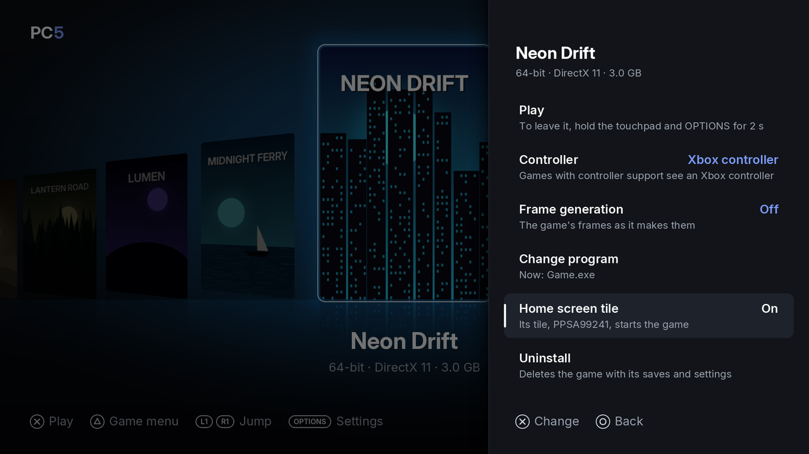
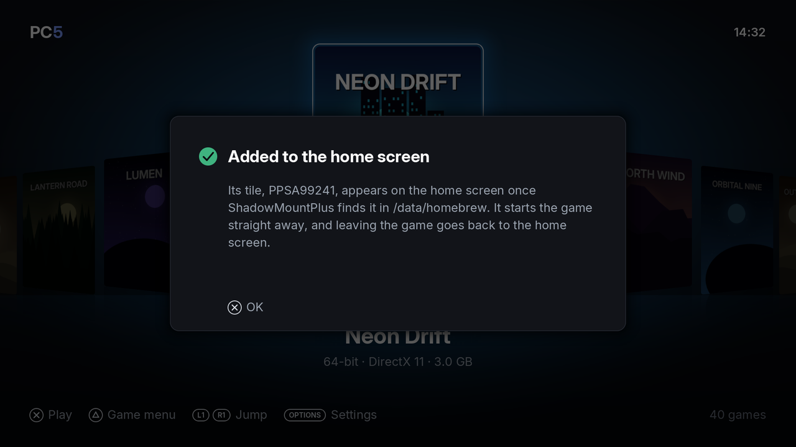

A game installed in PC5 can have its own tile on the PS5's home screen. Choosing the tile starts PC5 straight into that game, without going through the library, and leaving the game takes you back to the home screen. The tile shows the game's cover. Tiles were added in PC5 1.3.0.

*The game's menu: Home screen tile is On, with the tile's title ID.*

## What you need

PC5 writes the tile in `/data/homebrew` in the [PS5 Forwarder Format](https://github.com/heydemoura/ps5-forwarder-format). For the tile to work you need, on the console:

- **ShadowMountPlus**, or another homebrew mounter that registers the apps in `/data/homebrew`. The tile appears on the home screen once the mounter has registered it.
- **elfldr**, the payload loader (port 9021). The tile's program uses it to start the format's launcher, which then starts PC5.

## Adding a tile

1. In the library, choose the game and press **△**.
2. Choose **Home screen tile** and press **✕**.
3. PC5 says "Added to the home screen" and gives the tile's title ID (`PPSA99…`). The row now says **On**.
4. Wait for ShadowMountPlus to find the tile in `/data/homebrew`. It then appears on the home screen.

*PC5 has written the tile. It appears on the home screen once ShadowMountPlus finds it.*

## Using a tile

1. Choose the game's tile on the home screen.
2. PC5 opens and starts the game at once.
3. To leave, hold the **touchpad** and **Options** for two seconds, as always. You go back to the home screen, not to PC5.

## Changing the tile's picture

The tile's picture is the game's cover, on a blurred copy of itself. It is made when the tile is made. After you [change a game's cover](Covers), turn the tile off and on again to update it.

## Removing a tile

Do one of these:

- Turn the row off: **△ › Home screen tile** and **✕**. PC5 says "Taken off the home screen".
- [Uninstall the game](Installing-games#uninstalling-a-game). Its tile's folder is deleted with it.

Either way, PC5 deletes the tile's folder in `/data/homebrew`. If the tile is still on the home screen after that, delete it there.

## If something goes wrong

| What you see | What to do |
| --- | --- |
| The tile doesn't appear on the home screen | Check that ShadowMountPlus (or your mounter) is running, and that the tile's folder (`/data/homebrew/PPSA99…`) is there. |
| The tile does nothing | Check that elfldr is running: the tile needs it to start PC5. |
| "This tile's game can't start" | The game isn't in PC5 any more, or can't start. Take the tile off the home screen, or install the game again. |
| "The tile wasn't made" | PC5 gives the reason under the title. Check the free space and that `/data/homebrew` can be written. |
