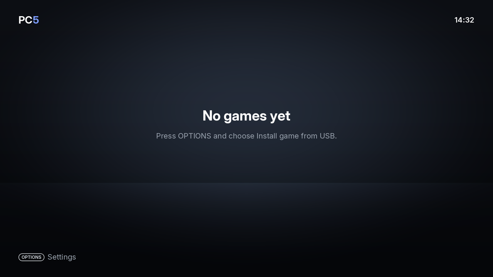
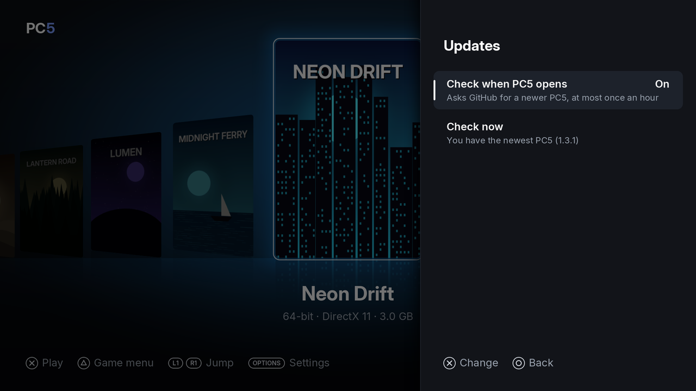
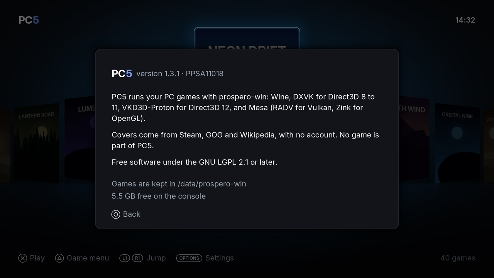

PC5 is a homebrew app: you copy it to the console once, and replace it with a newer version when one comes out. Your games, saves and settings are kept outside the app's folder, so updating PC5 never touches them. This page covers installing PC5, updating it, checking for new versions and finding the version you have.

## Installing PC5

1. Open the [Releases page](https://github.com/bornaradusin/PC5/releases) and download `PPSA11018.zip` from the newest release.
2. Unzip it. You get a folder called `PPSA11018`.
3. Copy the `PPSA11018` folder to the console the way you add any homebrew app.
4. Start **PC5** from the home screen.

The first time, the library is empty. Press **Options** and choose **Install games from USB** to add your first game (see [Installing games](Installing-games)).

*PC5 the first time it opens: the library is empty.*

## Updating PC5

1. Download the new `PPSA11018.zip` from the [Releases page](https://github.com/bornaradusin/PC5/releases) and unzip it.
2. Replace the `PPSA11018` folder on the console with the new one, the way you added PC5.
3. Start PC5, then check the version in **Settings › About PC5**.

Your games, saves and settings are in `/data/prospero-win`, not in the app's folder, so they stay where they are. There is no need to reinstall your games.

When a new version brings something games need (for example new video and sound decoders, or a newer DXVK), a game installed with an older PC5 gets it the next time it starts. That first start can take a little longer.

## Checking for a newer version

PC5 can ask GitHub whether a newer release is out. Open **Settings › Updates**.

*Settings › Updates: the check when PC5 opens, and the result of the last check.*

| Row | What it does |
| --- | --- |
| Check when PC5 opens | **On** (the default): PC5 asks GitHub when it opens, at most once an hour. **Off**: it only asks when you choose Check now. |
| Check now | Asks GitHub straight away and shows the answer under the row. |

The answer is one of these:

| Message | Meaning |
| --- | --- |
| You have the newest PC5 (1.4.0) | No newer release is published. |
| PC5 1.x.y is available on GitHub | A newer release is out. The console also shows a notification, once for each new release. |
| GitHub didn't answer: is the console online? | The check failed. Check the console's internet connection and try again. |
| Not checked yet | PC5 hasn't asked since it was installed. |

PC5 only tells you about a new version. It never downloads or installs anything by itself: you update it as described above.

## Which version do I have?

Open **Settings › About PC5** (press **Options** in the library). It shows the version, the title ID, where games are kept and the free space on the console.

*Settings › About PC5: the version, where games are kept and the free space.*

Always give this version when you [report a problem](Reporting-a-problem).

## Removing PC5

Deleting the `PPSA11018` app removes PC5, but not your games: they stay in `/data/prospero-win`. If you want them gone too, [uninstall them](Installing-games#uninstalling-a-game) in PC5 first. Turn off any [home screen tiles](Home-screen-tiles) first as well, as a tile only works while PC5 is installed.
