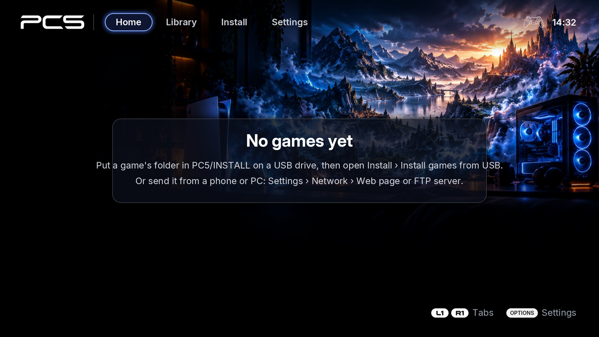
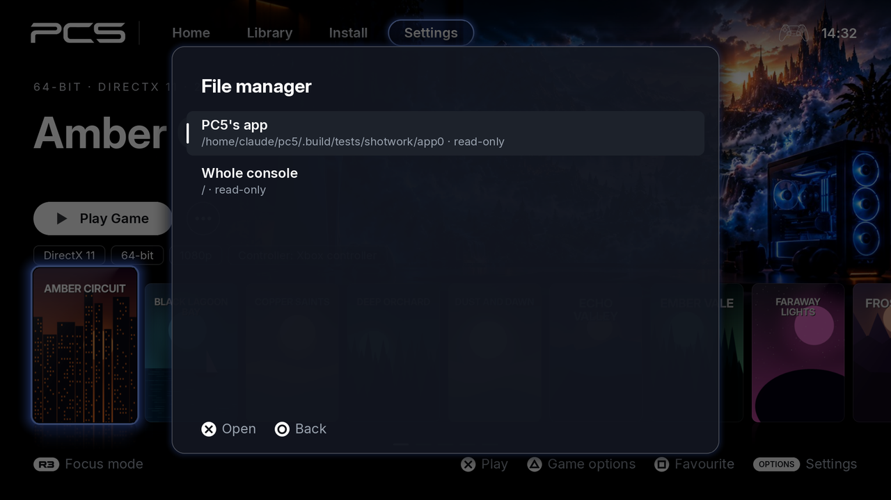
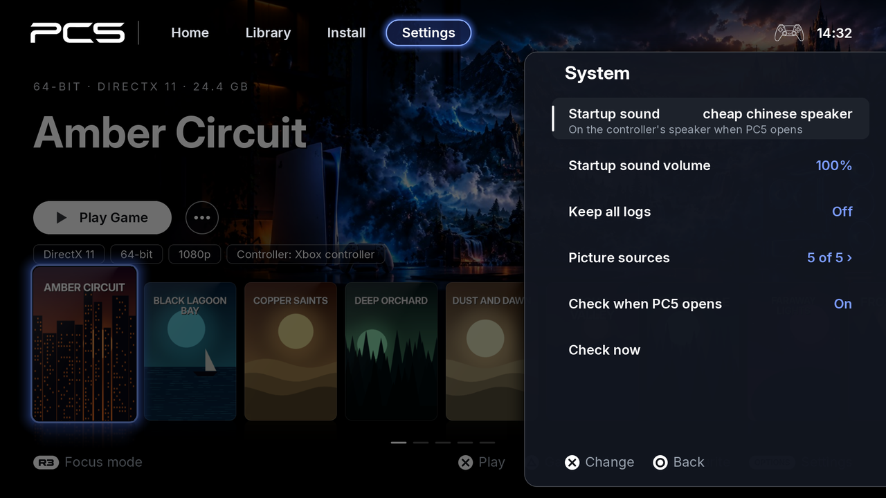

PC5 is a homebrew app: you copy it to the console once. From 1.7.0 on, PC5 updates itself from GitHub when a newer version comes out; you can still replace it by hand. Your games, saves and settings are kept outside the app's folder, so updating PC5 never touches them. This page covers installing PC5, updating it, checking for new versions and finding the version you have.

## Installing PC5

1. Open the [Releases page](https://github.com/bornaradusin/PC5/releases) and download `PPSA11018.zip` from the newest release.
2. Unzip it. You get a folder called `PPSA11018`.
3. Copy the `PPSA11018` folder to the console the way you add any homebrew app.
4. Start **PC5** from the home screen.

The first time, the library is empty. Open the **Install** tab (R1 twice) and choose **Install games from USB** to add your first game (see [Installing games](Installing-games)).

*PC5 the first time it opens: the library is empty.*

## Updating PC5

### From PC5 (1.7.0 and newer)

When PC5 opens and a newer release is out on GitHub, it asks: **Update now** or **Later**. Later leaves it for **Settings › System › Update now**.

1. Choose **Update now**. PC5 downloads the new version from the release, unpacks it and checks every file, then puts the new files in place of its own. A progress bar shows the download and the unpacking; **○** stops it until the files are put in place, and PC5 is then as it was.
2. When it says the new version is installed, press **✕** (**Restart PC5**). PC5 starts again as the new version.
3. Check the version in **Settings › About PC5**.

From 1.9.0, PC5 downloads only what changed since the release before, when it can: each release has, beside the whole app (`PPSA11018.zip`), an update zip (`PPSA11018-update.zip`) with only the files that differ from the release before it and the new release's list of its files. PC5 uses it when every other file of the new release is on the console as it was released (it checks each against its list, `pc5/manifest.txt`). Otherwise, for example when you skipped a version or a file of PC5's was changed, it downloads the whole app as before. The first update to 1.9.0 downloads the whole app, as PC5 1.8.8 doesn't know the update zip; from 1.9.0 to the next version on, an update is usually a small download. From 1.9.7, PC5 tells before it downloads anything which one it will be: only what changed when you have the version before, the whole app when you are more than one version behind, with its size.

PC5 1.7.0 closes instead of restarting, and the console then shows error CE-108255-1; the update is installed all the same, so just open PC5 again. From 1.8.0 on, PC5 restarts by itself.

PC5 needs room for the download and its unpacked files on the drive it is installed on: about four times the size of the zip it downloads, freed again when it is done. It finds its own folder on the console's drives (in `homebrew`, `etaHEN/games` or at the top of a USB or extended drive). The folder stays where it is and only PC5's own files in it change; files you added at the top of the folder stay. If PC5 is on the console more than once, it asks you to delete the copy you don't use first. If something goes wrong before the new files are put in place, PC5 says why and stays as it was; if the console turns off while they are being put in place, PC5 finishes the job the next time it opens, and then restarts as the new version.

### By hand

1. Download the new `PPSA11018.zip` from the [Releases page](https://github.com/bornaradusin/PC5/releases) and unzip it.
2. Replace the `PPSA11018` folder on the console with the new one, the way you added PC5.
3. Start PC5, then check the version in **Settings › About PC5**.

Either way, your games, saves and settings are in `/data/prospero-win`, not in the app's folder, so they stay where they are. There is no need to reinstall your games.

When a new version brings something games need (for example new video and sound decoders, or a newer DXVK), a game installed with an older PC5 gets it the next time it starts. That first start can take a little longer.

### The home screen background

From 1.8.7, PC5 has a background of its own on the PS5's home screen, shown while PC5 is chosen there. If the home screen doesn't show it after an update:

1. On the home screen, choose PC5, press **Options** and choose **Delete**.
2. Reload ShadowMountPlus. It installs PC5 again, and the home screen shows the new background.

Your games, saves and settings are in `/data/prospero-win`, so they stay where they are.

## Checking for a newer version

PC5 can ask GitHub whether a newer release is out. Open **Settings › System**.

*Settings › System: the startup sound and its volume, the logs, the picture sources and the update rows.*

| Row | What it does |
| --- | --- |
| Check when PC5 opens | **On** (the default): PC5 asks GitHub each time you open it, and offers to update when a newer version is out (after a game, at most once an hour). **Off**: it only asks when you choose Check now. |
| Check now | Asks GitHub straight away and shows the answer under the row. |
| Update now | Shows while a newer release is out: downloads it and installs it (see [Updating PC5](#updating-pc5)). |

The answer is one of these:

| Message | Meaning |
| --- | --- |
| You have the newest PC5 (1.x.y) | No newer release is published. |
| PC5 1.x.y is available on GitHub | A newer release is out. When PC5 opens it asks whether to update; after Check now, the console shows a notification, once for each new release. |
| GitHub didn't answer: is the console online? | The check failed. Check the console's internet connection and try again. |
| Not checked yet | PC5 hasn't asked since it was installed. |

PC5 never updates without asking: it downloads and installs a new version only when you choose Update now.

## Which version do I have?

Open **Settings › About PC5** (press **Options** in the library). It shows the version, the title ID, where games are kept and the free space on the console.

*Settings › About PC5: the version, where games are kept and the free space.*

Always give this version when you [report a problem](Reporting-a-problem).

## Removing PC5

Deleting the `PPSA11018` app removes PC5, but not your games: they stay in `/data/prospero-win`. If you want them gone too, [uninstall them](Installing-games#uninstalling-a-game) in PC5 first. Turn off any [home screen tiles](Home-screen-tiles) first as well, as a tile only works while PC5 is installed.
