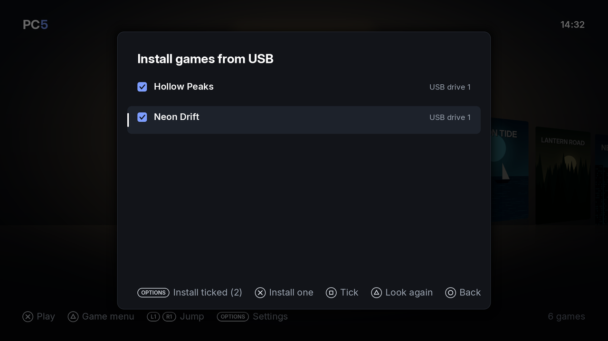
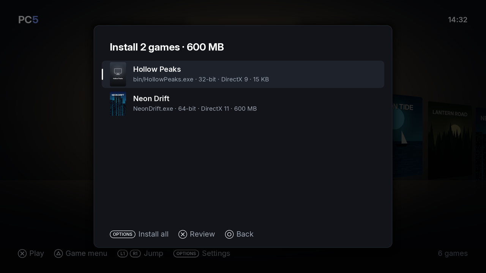
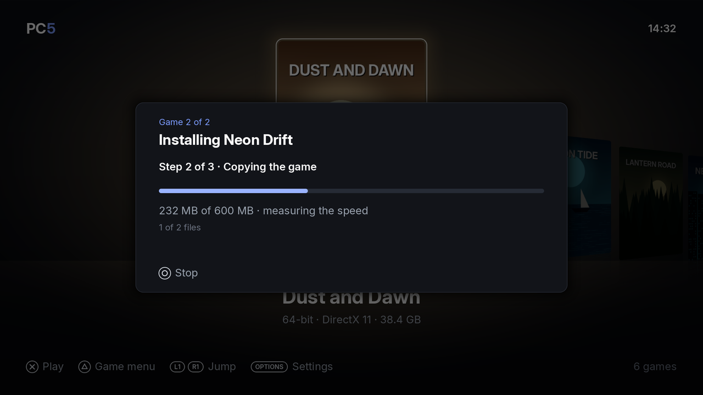
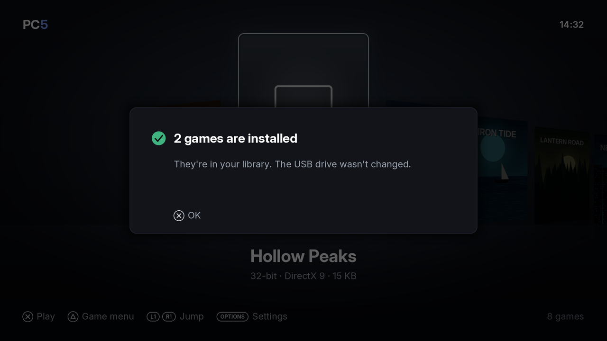
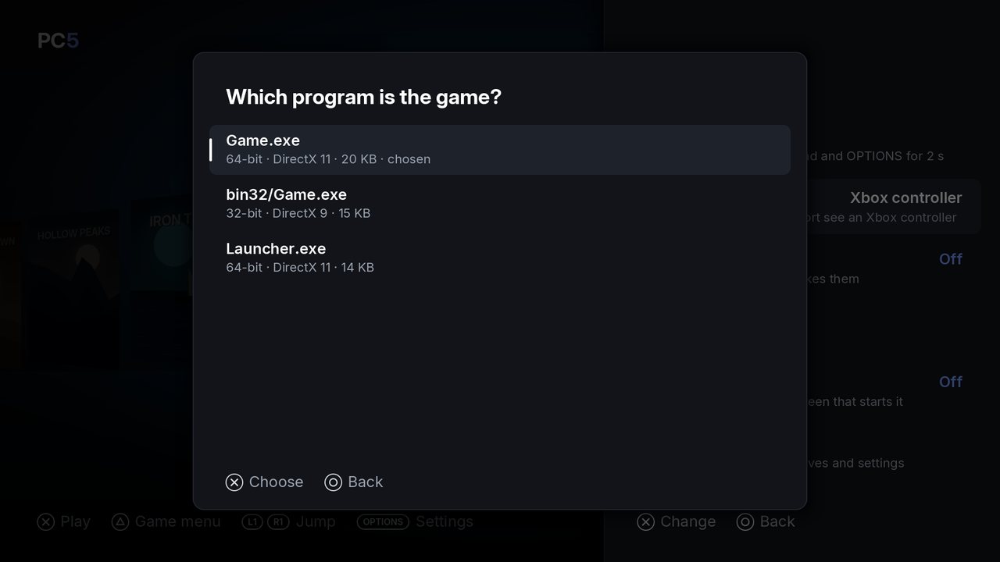
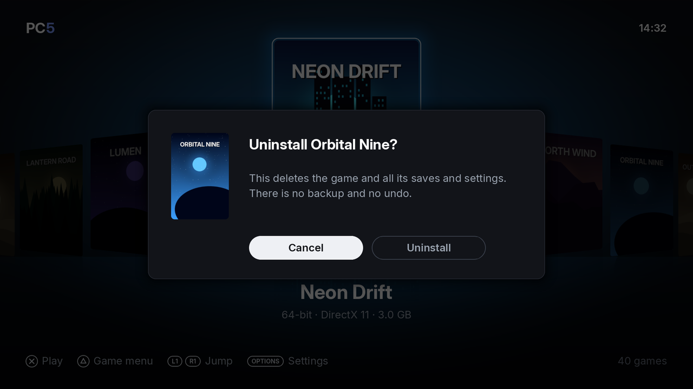

PC5 installs games from a USB drive. You put each game's installed folder on the drive, choose it in PC5, and PC5 copies it to the console once, checks the copy against the drive and adds the game to your library. You can install one game at a time or several in a row. This page also covers choosing the right program for a game and uninstalling games.

## Preparing the USB drive

1. Format the drive as **exFAT**.
2. Copy each game's installed folder (the folder with the game's `.exe` in it) to the top of the drive, or into a folder called `Games` at the top.
3. Name each folder the way you want the game to be called in PC5. The folder's name becomes the game's name.
4. Plug the drive into the PS5.

For example:

```text
USB drive (exFAT)
├── Neon Drift/
│   ├── NeonDrift.exe
│   ├── cover.png          optional: your own cover (see Covers)
│   └── data/
└── Games/
    └── Hollow Peaks/
        └── bin/
            ├── HollowPeaks.exe
            └── launch.txt  optional: launch options (see Launch options)
```

Good to know:

- Use the game as it is installed on a PC, not its installer. PC5 copies the folder as it is and doesn't run setup programs.
- The game's program can be in a subfolder. PC5 looks up to six folder levels deep.
- File and folder names must be names Windows accepts: none of `< > : " | ? * \`, no name ending in a dot or a space, and no reserved names such as `CON` or `NUL`.
- A `steam_appid.txt` at the top of the folder (many Steam games have one) helps PC5 find the right cover.
- You can put a `cover.jpg`, `cover.jpeg` or `cover.png` at the top of the folder to use your own cover. See [Covers](Covers).
- You can put a `launch.txt` beside the game's `.exe` to give it launch options. It is copied with the game. See [Launch options](Launch-options).
- PC5 never writes to the USB drive.

## Installing one game

1. In the library, press **Options** to open Settings, and choose **Install games from USB**.
2. PC5 lists the game folders it found on every USB drive plugged in. Choose one and press **✕**.
3. PC5 reads the folder, finds its program and looks for its cover. The review screen opens.
4. Check the review screen, then press **✕** to install.


*Install games from USB: the game folders PC5 found. Two are ticked for installing in a row.*

| Button | On the folder list |
| --- | --- |
| ✕ | Install the chosen folder (after its review screen) |
| □ | Tick or untick the folder |
| Options | Install the ticked folders (shows how many are ticked) |
| △ | Look at the USB drives again (after plugging in a drive) |
| ○ | Back to Settings |

The review screen shows what PC5 is about to do:


*The review screen: the cover PC5 found, the program it will start, the size and the space left.*

| Row | What it tells you |
| --- | --- |
| Program | The `.exe` PC5 will start, inside the game's folder |
| Runs as | 32-bit or 64-bit, and what the game draws with (DirectX 8 to 12, Vulkan, OpenGL, DirectDraw or plain Windows) |
| Size | The folder's size and how many files it has |
| Space | The free space left after installing, or "not enough" |

| Button | On the review screen |
| --- | --- |
| ✕ | Install (in a list of several games: Done) |
| L1 / R1 | Show the other covers PC5 found. See [Covers](Covers). |
| □ | Choose another program, when the folder has more than one |
| ○ | Back to the folder list |

If the program is a .NET program, the review screen says so: it runs with Wine Mono, which PC5 sets up the first time a .NET game starts. See [.NET games](Playing-games#net-games).

## Installing several games in a row

1. In **Install games from USB**, tick each game folder with **□**.
2. Press **Options** (Install ticked). PC5 reads every folder and looks for each cover. This is "Getting ready".
3. A list shows each game with its cover, program, bits, graphics and size. Press **✕** on a game to open its review screen, change its cover or program, then press **✕** (Done) to go back to the list.
4. Press **Options** (Install all). PC5 installs the games one after another.


*Several games ready to install. A game with no cover online gets a cover made from its icon.*

Before it starts, PC5 checks that there is room for all of them. If not, it says how much they need and how much is free: go back and untick some. A folder without a program PC5 can start is skipped, and the summary at the end says why.

## While a game installs

Each game is installed in three steps:

1. **Setting up the game's Windows**: a new Windows folder of its own for the game.
2. **Copying the game**: every file in the folder, with the speed and the time left.
3. **Checking the copy against the USB drive**: every file is read back and compared.


*Installing the second game of two: step 2 of 3, copying.*

To stop, press **○**. For one game, choose **Stop**: everything copied so far is deleted. When installing several, choose **Stop this game** (the next one installs) or **Stop all**. Games already installed stay. The USB drive isn't changed either way.

When it is done, PC5 says the game is installed, and it appears in the library, chosen. After several games, a summary says how many were installed, and why any were not.


*Both games are installed and in the library.*

If the console is switched off during an install, PC5 deletes the unfinished copy the next time it starts ("Finishing an install or uninstall that was cut short").

PC5 needs the game's size plus about 1.5 GB of free space before it starts copying.

## Choosing the right program

A game's folder often has several programs: the game, a launcher, a settings tool, an uninstaller. PC5 ranks them and starts the one most likely to be the game. It leaves out installers, uninstallers, crash reporters, redistributables and similar tools.

If PC5 picked the wrong one (for example, the game closes at once, or a settings window opens instead of the game):

1. In the library, choose the game and press **△**.
2. Choose **Change program**. The row shows the program it starts now.
3. Choose the game's own program from the list and press **✕**.


*Change program: every program in the game's folder, with its bits, graphics and size.*

PC5 says "*Game* starts *program* now". The change takes effect the next time you start the game.

Choose the game itself rather than a launcher that starts it: Wine on the console doesn't start a second program from a launcher. Change program only works for games PC5 installed.

## Uninstalling a game

There are two ways:

- In the library, choose the game, press **△** and choose **Uninstall**.
- Or press **Options**, choose **Uninstall game**, and choose the game from the list.

PC5 asks first. **Cancel** is chosen by default: move to **Uninstall** and press **✕** to go ahead.


*PC5 asks before it uninstalls. There is no backup and no undo.*

Uninstalling deletes the game and everything it made: its saves, its settings, its shader cache, its cover and its [home screen tile's](Home-screen-tiles) folder. There is no backup and no undo. To keep a game's saves, copy its folder `/data/prospero-win/prefixes/<game>/` off the console first (see [Files and folders](Files-and-folders)).

## What runs and what doesn't

PC5 handles every game the same way. It reads the game's program to see whether it is 32-bit or 64-bit and what it draws with, and sets the game up to match:

| The game uses | It runs through |
| --- | --- |
| Direct3D 8, 9, 10, 11 | DXVK 2.6.2-prospero2, with PC5's patch |
| Direct3D 12 | VKD3D-Proton 3.0.1 |
| Vulkan | RADV directly |
| OpenGL | Mesa Zink |
| DirectDraw or plain Windows drawing | Wine itself |
| .NET Framework | Wine Mono 11.3.0 |

Games that write text with Windows' fonts get Liberation for Arial, Times New Roman and Courier New (made to take the same space), and Droid Sans Fallback for Windows' Chinese, Japanese and Korean fonts.

A game that carries Microsoft's Visual C++ runtimes, Direct3D shader compilers (`d3dcompiler_*.dll`) or D3DX helpers (`d3dx9_*.dll`, `d3dx10_*.dll`, `d3dx11_*.dll`) beside its program uses its own copies first, as Proton does. Wine's own stand in for those it doesn't carry.

Games' videos and compressed sound (Media Foundation, DirectShow, Windows Media and DMOs) are decoded with FFmpeg: H.264, WMV and VC-1, MPEG-1 and 2, AAC, WMA, MP3 and others.

What won't run:

- Games that need Steam, Epic, EA or Ubisoft's launcher running.
- Games with online DRM or anti-cheat.
- .NET programs that mix .NET and C++ (C++/CLI), and some WPF programs. Other .NET games run with Wine Mono.
- Programs that aren't Windows programs.

Whether a game runs is only known by trying it. PC5 makes no promise about any game. If a game doesn't start or crashes, PC5 keeps its log: see [Reporting a problem](Reporting-a-problem).
