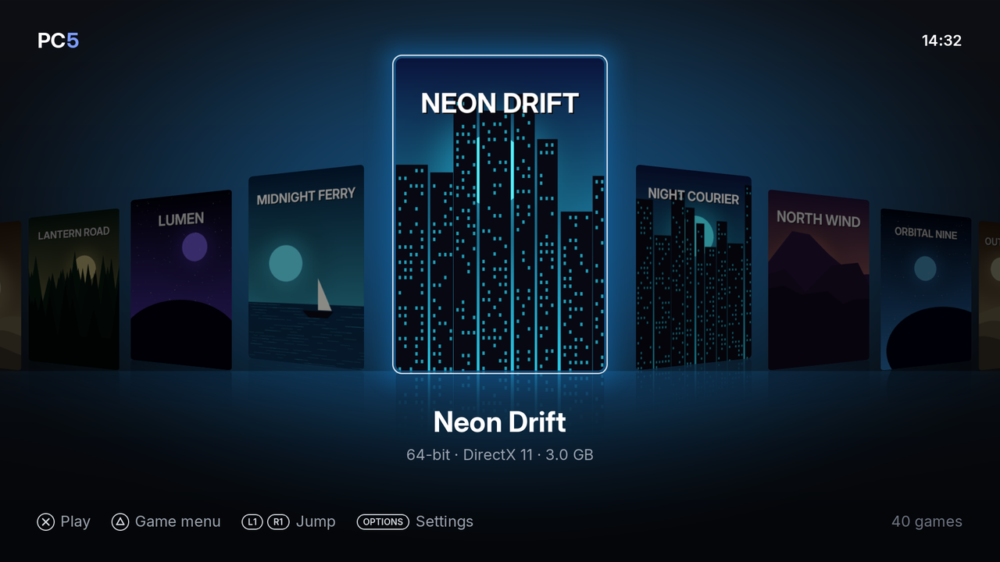
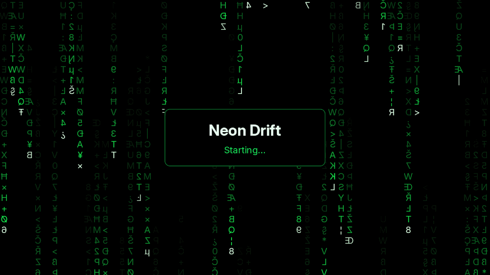
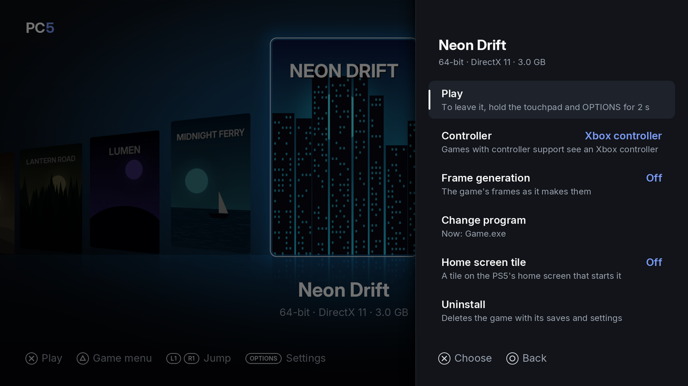
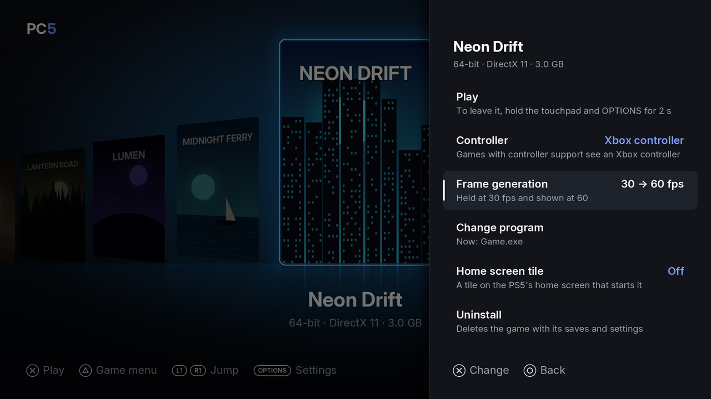

Your installed games are in PC5's library, a row of covers sorted by name. From there you start a game, open its menu to set it up, and come back to PC5 when you leave it. This page covers the library, starting and leaving a game, the game menu and frame generation.

## The library

*The library. Under the chosen game: its name, 32-bit or 64-bit, what it draws with, and its size.*

| Button | In the library |
| --- | --- |
| Left / right, or the left stick | Move between games |
| L1 / R1 | Jump to the first game of the previous or next letter |
| ✕ | Play the chosen game |
| △ | The chosen game's menu |
| Options | Settings |

If the console is set to confirm with **○**, PC5 follows it: **○** plays and chooses, and **✕** goes back.

When PC5 opens, the game you played last is chosen. The library holds up to 128 games. The clock at the top right is the console's.

### Using a USB keyboard in PC5

A USB keyboard works in PC5's own screens too:

| Key | Does what |
| --- | --- |
| Arrow keys | Move |
| Enter or Space | ✕ (choose) |
| Escape or Backspace | ○ (back) |
| F1, Tab or the menu key | Options |
| F2 or Delete | □ |
| F3 | △ |
| Page Up / Page Down | L1 / R1 |

## Starting a game

1. Choose the game in the library.
2. Press **✕** (or choose **Play** in its menu).

PC5 shows a loading screen with the game's name until the game shows its first picture.

*The loading screen, shown until the game draws its first picture.*

Good to know:

- Each game's Windows language is the PS5's language, so a game that follows the Windows language follows the console.
- PC5's [settings](Settings) (overlay, vibration, light bar, triggers) and the game's own settings (controller, frame generation, [launch options](Launch-options)) are read each time the game starts. A change takes effect the next time you start it.

## Leaving a game

Hold the **touchpad** and **Options** together for **two seconds**.

1. The controller gives a short buzz: the hold was taken.
2. PC5 asks the game to close (as Alt+F4 does on a PC), so it can save.
3. If the game hasn't closed after five seconds, it is ended.
4. You are back in PC5. If you started the game from its [home screen tile](Home-screen-tiles), you are back on the home screen.

This works in every controller mode and can't be remapped. Don't use it to close a pop-up in the game: it always leaves the game. See [a game's Windows pop-ups](Controllers#a-games-windows-pop-ups) for those.

If the game crashed or closed before showing anything, PC5 tells you when it opens again, and keeps the log. See [Reporting a problem](Reporting-a-problem).

## The game menu

Choose a game in the library and press **△**.

*The game menu. Its settings are kept for this game only.*

| Row | What it does |
| --- | --- |
| Play | Starts the game. |
| Controller | What the game sees: **Xbox controller** (the default), **DualSense**, or **Keyboard & mouse**. Press **✕** or left / right to change it. See [Controllers](Controllers). |
| Button mapping | Only with Keyboard & mouse: what each button and stick sends. See [Controllers](Controllers#button-mapping). |
| Frame generation | **Off** (the default) or **30 → 60 fps**. See [Frame generation](#frame-generation) below. |
| Change program | The program PC5 starts for this game ("Now: …"). Choose another one if PC5 picked the wrong one. See [Choosing the right program](Installing-games#choosing-the-right-program). |
| Home screen tile | **Off** or **On**: a tile on the PS5's home screen that starts this game. See [Home screen tiles](Home-screen-tiles). |
| Uninstall | Deletes the game with its saves and settings, after asking. See [Uninstalling a game](Installing-games#uninstalling-a-game). |

Press **○** or **△** to close the menu.

## Frame generation

Frame generation shows a game at 60 fps when it runs at 30. It is set for each game: **△ › Frame generation**, **Off** by default.

*Frame generation on: the game is held at 30 fps and shown at 60.*

How it works: the game is held at 30 fps, and before each of its frames PC5 shows one made between it and the one before, with [ps5-framegen](https://github.com/Swordpdf/ps5-framegen)'s interpolator (AMD FSR3's optical flow).

What to expect:

- It suits games that keep 30 fps or a little more. When a game falls below 30, its frames are shown as they come, without frames in between, until it keeps up again.
- Frames made in between can show smearing around fast movement and at the screen's edges.
- The game reacts a little later than without it.
- The overlay's FPS counts every frame shown, the made ones too, so it shows about 60.
- It works with games drawn with Direct3D 8 to 12, Vulkan or OpenGL. It doesn't apply to DirectDraw or plain Windows drawing, nor to 10-bit (HDR) output.
- A change takes effect the next time the game starts.

## The overlay

PC5 can show an overlay over every game: FPS, frame time, CPU usage, CPU and SoC temperatures, and memory. Turn it on in **Settings › Overlay**. See [Settings](Settings#overlay).

## When a game doesn't start

If PC5 can't start a game, it says why: for example "*Game* can't start" with the reason. See [Troubleshooting](Troubleshooting) for PC5's messages and what to do about them.

Games installed in `/data/prospero-win` some other way (not with PC5) show up in the library too, and get a cover the first time PC5 opens. Their program is set in their prospero-win profile, so **Change program** doesn't apply to them.
