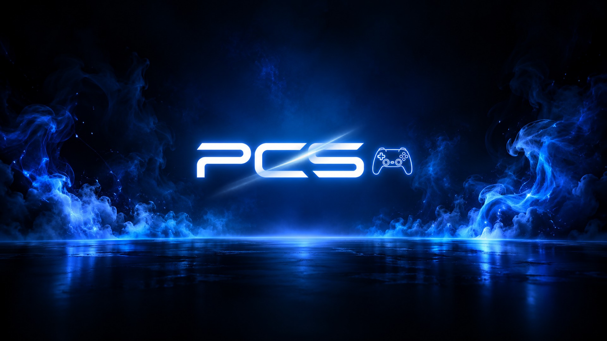
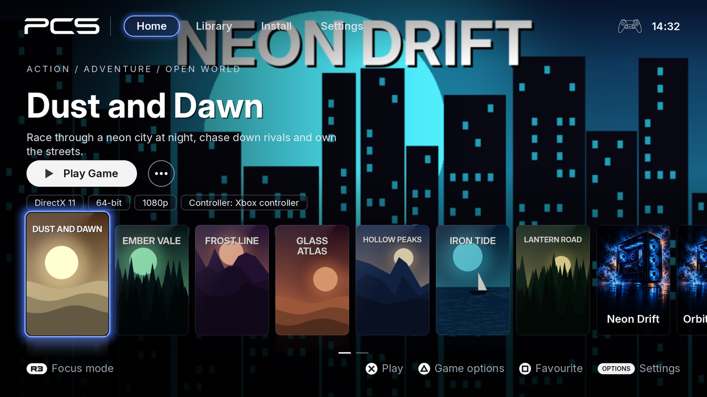
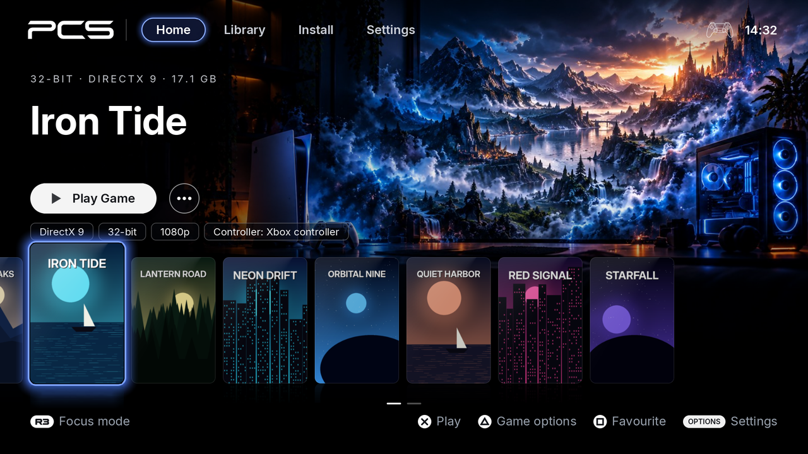
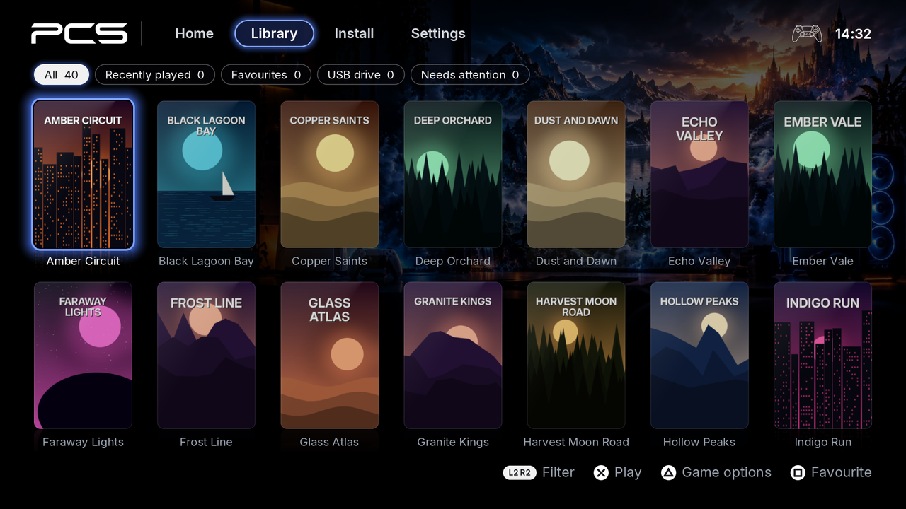
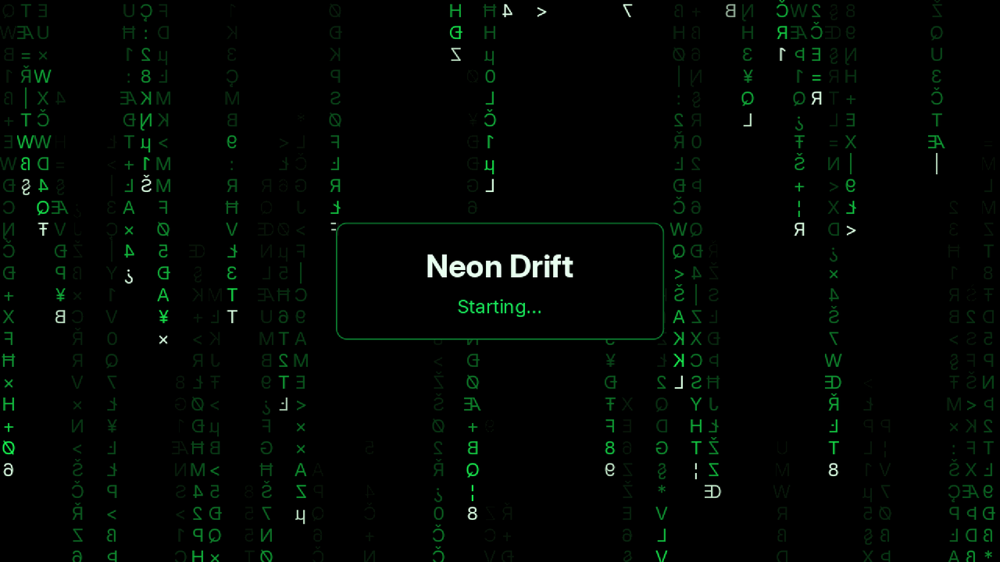
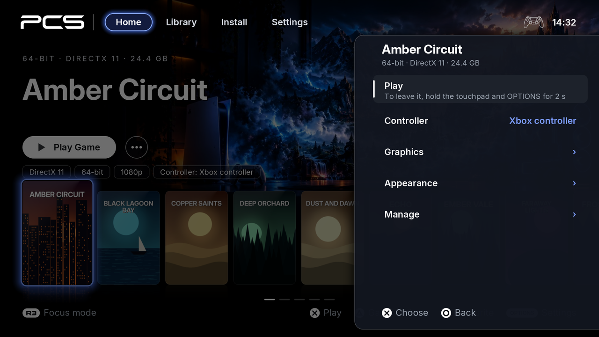
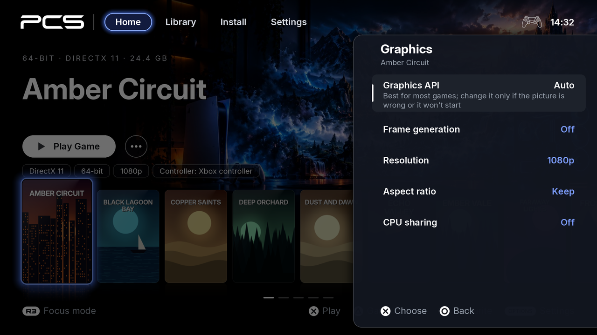
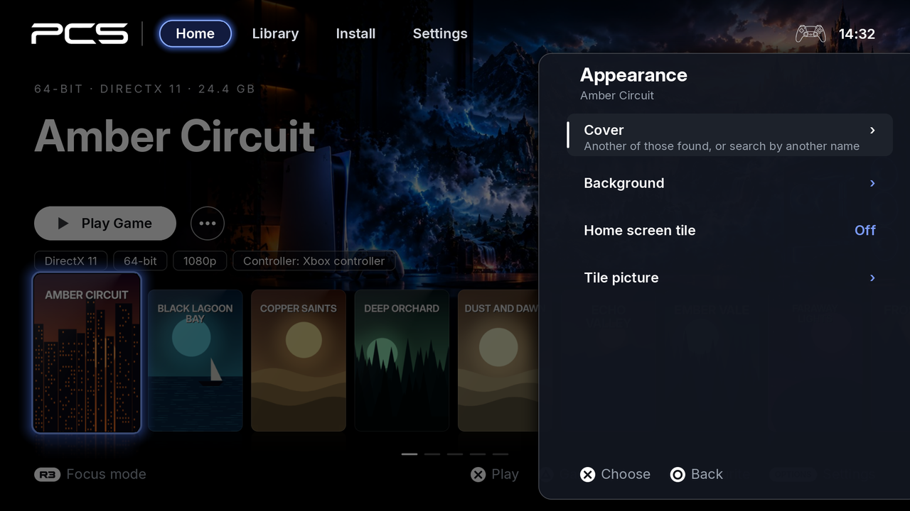
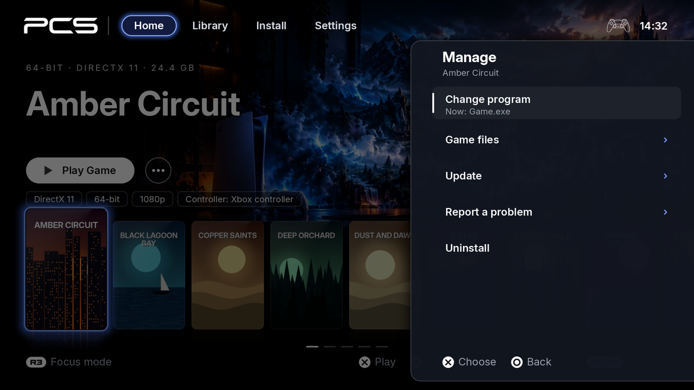
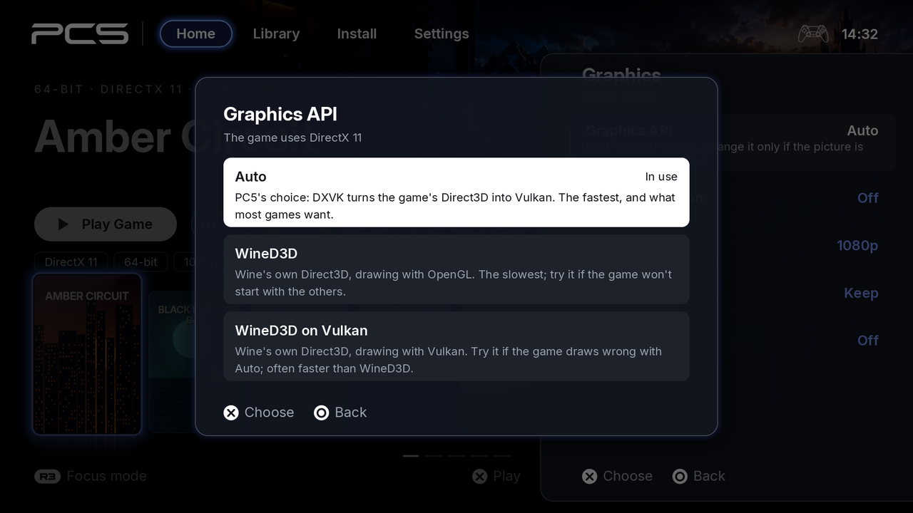

Your installed games are on PC5's **Home** tab, a row of covers under the chosen game's background, and on the **Library** tab, all of them in a grid. From there you start a game, open its menu to set it up, and come back to PC5 when you leave it. This page covers Home and Library, starting and leaving a game, the game menu and frame generation.

*PC5 opening.*

## Home

*Home. Behind it, the chosen game's background (see [Backgrounds](Covers#backgrounds)); over it, its genres, its logo or name, a line about it, **Play Game**, **•••** for its menu, and its settings: what it draws with, 32-bit or 64-bit, its resolution and its controller. The chosen cover is lit in blue.*

A game without a background of its own shows PC5's picture instead, and a game without a cover shows PC5's cover with its name on it.

| Button | On Home |
| --- | --- |
| Left / right, or the left stick | Move between games |
| L1 / R1 | The previous or next tab: Home, Library, Compatibility, Install, Settings |
| ✕ | Play the chosen game |
| △ | The chosen game's menu |
| □ | Mark the game as a favourite, or unmark it (a star on its cover) |
| Down | Focus mode: only the game's picture (and its video), until **Up** |
| Options | Settings |

If the console is set to confirm with **○**, PC5 follows it: **○** plays and chooses, and **✕** goes back.

When PC5 opens, the game you played last is chosen. The library holds up to 128 games. The clock at the top right is the console's.

## Library

*Library: every game in a grid, with filters along the top.*

The filters are **All**, **Recently played** (newest first), **Favourites**, **USB drive** (games installed on a USB drive) and **Needs attention** (games that can't start as they are, with the reason on Home). **L2** / **R2** change the filter; ✕, △ and □ work as on Home.

## Install and Settings

**Install** has installing and uninstalling games and the game compatibility list (the same as **Settings › Game maintenance**; see [Installing games](Installing-games)). **Settings** is PC5's settings (see [Settings](Settings)).

### Using a USB keyboard in PC5

A USB keyboard works in PC5's own screens too:

| Key | Does what |
| --- | --- |
| Arrow keys | Move |
| Enter or Space | ✕ (choose) |
| Escape or Backspace | ○ (back) |
| F1, Tab or the menu key | Options |
| F2 or Delete | □ |
| F3 | △ |
| Page Up / Page Down | L1 / R1 |
| Home / End | L2 / R2 |
| F4 | R3 |

## Starting a game

1. Choose the game in the library.
2. Press **✕** (or choose **Play** in its menu).

PC5 shows a loading screen with the game's name until the game shows its first picture.

*The loading screen, shown until the game draws its first picture.*

Good to know:

- Each game's Windows language is the PS5's language, so a game that follows the Windows language follows the console.
- PC5's [settings](Settings) (overlay, vibration, light bar, triggers) and the game's own settings (controller, frame generation, [launch options](Launch-options)) are read each time the game starts. A change takes effect the next time you start it.

## Leaving a game

Hold the **touchpad** and **Options** together for **two seconds**.

1. The controller gives a short buzz: the hold was taken.
2. PC5 asks the game to close (as Alt+F4 does on a PC), so it can save.
3. If the game hasn't closed after five seconds, it is ended.
4. You are back in PC5. If you started the game from its [home screen tile](Home-screen-tiles), you are back on the home screen.

This works in every controller mode and can't be remapped. Don't use it to close a pop-up in the game: it always leaves the game. See [a game's Windows pop-ups](Controllers#a-games-windows-pop-ups) for those.

If the game crashed or closed before showing anything, PC5 tells you when it opens again, and keeps the log. See [Reporting a problem](Reporting-a-problem).

## The game menu

Choose a game in the library and press **△**. Its menu has what you change most, and three groups: **Graphics**, **Appearance** and **Manage**. The row chosen says what it does under its name.

*The game menu. Its settings are kept for this game only.*

| Row | What it does |
| --- | --- |
| Play | Starts the game. |
| Controller | What the game sees: **Xbox controller** (the default), **DualSense**, or **Keyboard & mouse**. Press **✕** or left / right to change it. See [Controllers](Controllers). |
| Button mapping | Only with Keyboard & mouse: what each button and stick sends. See [Controllers](Controllers#button-mapping). |
| Mouse pointer | **Normal** (the default): the pointer stays as the game shows it. **Auto-hide**: it hides when you haven't moved it or clicked for 5 seconds, for a game that leaves it in a corner. See [Controllers](Controllers). |
| Graphics › | Graphics mode, frame generation, resolution, aspect ratio, game memory, graphics memory and stutter fix. See [Graphics](#graphics). |
| Sound output | **Stereo** (the default), **5.1** or **7.1**: how many speakers the game is told the console has. With 5.1 or 7.1 the game plays each sound on its own speaker of a surround system, and the PS5 sends it on as it does its own games' sound. If the game is silent or sound only comes from the front, set it back to Stereo. Press **✕** or left / right to change it. From 2.2.2-test. |
| Appearance › | The game's cover, its background (a picture or a video), its loading picture, its home screen tile, the tile's picture and its music. See [Appearance](#appearance). |
| Manage › | The program PC5 starts, its files, updating the game and uninstalling it. See [Manage](#manage). |

**○** goes back from a group to the menu, and from the menu to the library. **△** closes the menu from anywhere in it.

From 2.1.9, **□ About** on a setting opens a window that says in plain words what the setting does and what each choice means. **○** closes it.

### Graphics

*Graphics: what changes how the game is drawn.*

| Row | What it does |
| --- | --- |
| Graphics mode | Only for games drawn with Direct3D or DirectDraw: how the game's pictures are made. **Auto** suits almost every game. See [Graphics mode](#graphics-mode) below. |
| Frame generation | **Off** (the default) or **30 → 60 fps**. See [Frame generation](#frame-generation) below. |
| Resolution | Only for games drawn with Direct3D, Vulkan or OpenGL: **1080p** (the default), **1440p** or **4K**. See [Resolution](#resolution) below. |
| Aspect ratio | **Keep** (the default) or **Stretch**. See [Aspect ratio](#aspect-ratio) below. |
| Game memory | Only for 32-bit games: **Auto** (the default from 1.9.8) or **4 GB**. Auto is as on Windows: a game made for more memory (its program says so) gets 4 GB of address space, any other gets 2 GB. 4 GB gives every game 4 GB, room for big textures and mods, but an older game not made for it can crash with it. From 1.4.0 to 1.9.7 every game had 4 GB; a game left as it was is Auto from 1.9.8. |
| Graphics memory | For 32-bit games and for 64-bit Direct3D 10, 11 and 12 games: how much video memory the game is told the console has. The console's memory is shared between the game and its graphics, so less for graphics leaves more for the game. A 64-bit game has **2 GB**, **3 GB**, **Auto (4 GB)** (the default), **5 GB**, **6 GB** and **Maximum**; a 32-bit one **512 MB**, **1 GB**, **Auto (2 GB)** (the default), **3 GB** and **Maximum**. A game that crashes or says it ran out of memory: try a size below Auto. One that warns there is too little video memory: try one above, and go back a step if it then crashes. For a 32-bit game, Auto keeps to 2 GB because some older games misread more and refuse to start. The smaller sizes and 3 GB for 32-bit games are from 2.2.3; before 2.1.9 the setting was called Video memory, and Maximum was Full. |
| Stutter fix | **Off** (the default) or **On**. The console runs each of a game's threads on a CPU of its own until it waits, where Windows lets them take turns, so a game that keeps more threads busy than its 13 CPUs can stop for seconds at a time and carry on after a while, or after the PS button. **On** gives the game's threads turns, as on a PC. It applies the next time the game starts. Before 2.1.9 it was called CPU sharing. |

### Appearance

*Appearance: how the game looks in PC5 and on the home screen.*

| Row | What it does |
| --- | --- |
| Media settings and backup › | The game's pictures and media settings: **Cover**, **Background**, **Loading screen** and **Music, video and backup**, below. From 2.2.3; before, they were on Appearance itself. |
| Library music | For a game PC5 installed: an MP3 or WAV file (16-bit), copied to the console, that plays while the game's cover is chosen, fading in and out. **Remove library music** stops it. |
| Home screen tile | **Off** or **On**: a tile on the PS5's home screen, an app of its own that starts this game. See [Home screen tiles](Home-screen-tiles). |
| Tile picture | The tile's picture: a square one from SteamGridDB (with your key), or one made from its cover. See [The tile's picture](Home-screen-tiles#the-tiles-picture). |

**Media settings and backup:**

| Row | What it does |
| --- | --- |
| Cover | Another of the covers found for the game, one found for a name you type, or the card made from its icon. See [Changing a cover or background](Covers#changing-a-cover-or-background). |
| Background | Another of the backgrounds found, one found for a name you type, or none. See [Changing a cover or background](Covers#changing-a-cover-or-background). For a game PC5 installed, it opens **Background image** (that choice) and **Background video**: a silent H.264 video (MP4 or MOV, up to 1080p and 60 fps, at most 1 GB) copied to the console and played behind the cover, or **Remove background video** to go back to the picture. |
| Loading screen | For a game PC5 installed: the picture shown while it starts. **Choose image file** takes a JPEG or PNG from a USB drive or the console, **Use its background** uses the game's background picture, and **Use PC5's** goes back to PC5's own. See [Loading screen](Covers#loading-screen). |
| Music, video and backup | For a game PC5 installed: the music's volume and where it starts, where the video starts and ends its loop, how it fills the screen (Stretch, Fit or Fill), how much it's darkened, and **Export appearance backup** / **Restore appearance backup**: the game's pictures, music, video and these settings in one `.pc5look` file, on the console or a USB drive. Restoring checks the whole file first and keeps the game's files and saves. |

**□ on Cover, Background image, Loading screen, Tile picture, Library music or Background video: receive it from your phone.** PC5 shows a QR code: with the phone on the same network as the console (or the console on the phone's hotspot), scan it, choose one file and send it. Keep the QR code on screen until it's received; the link works for 10 minutes without use, and only on your network. A picture can be JPEG or PNG up to 20 MB, music up to 512 MB, a video up to 1 GB.

### Manage

*Manage: the game's program, a newer version, and uninstalling.*

| Row | What it does |
| --- | --- |
| Change program | The program PC5 starts for this game ("Now: …"). Choose another one if PC5 picked the wrong one. See [Choosing the right program](Installing-games#choosing-the-right-program). **□** on a program offers it at **Play** too (from 2.0.9): a game with an expansion that has a program of its own then asks which to start each time you play it, and the one you pick stays its program. **□** again stops offering it. |
| Steam emulator | Only for a game with Steam's library (`steam_api.dll` or `steam_api64.dll`): **Auto** (the default) or **Off**. See [Games made for Steam](#games-made-for-steam) below. |
| Game files | Only for games PC5 installed: the game's own folder, to copy, move, rename and delete its files (on its drive, for a game [installed on a USB drive](Installing-games#installing-a-game-on-a-usb-drive)). See [File manager](File-manager). |
| Update | Only for games PC5 installed: copies a newer version from the USB drive over the game. Its saves, settings and options stay. See [Updating a game](Installing-games#updating-a-game). |
| Report a problem | (From 2.0.4.) A QR code for GitHub's issue form, filled in from the game's newest log: the game, its program, PC5's version, what went wrong, the log's name and the game's settings. Attach that log on the form. See [Reporting a problem](Reporting-a-problem). |
| Uninstall | Deletes the game, keeping its saves or not, after asking. See [Uninstalling a game](Installing-games#uninstalling-a-game). |

## Games made for Steam

Steam doesn't run on the console. A game that asks Steam's library (`steam_api.dll` or `steam_api64.dll`, Valve's) for Steam would quit, so with **△ › Manage › Steam emulator** on **Auto** (the default), PC5 puts the [gbe_fork](https://github.com/Detanup01/gbe_fork) Steam emulator in its place each time the game starts, and the game plays as if Steam were there, offline:

- Valve's library is kept beside it, as `steam_api64.dll.pc5-valve`. **Off** puts it back at the next start.
- The emulator's settings are in a `steam_settings` folder beside it: the game's app ID when the game has a `steam_appid.txt`, the player's name "Player", offline, and no DLC the game doesn't have. Change them there if a game needs something else; PC5 doesn't write over them.
- A game that has a Steam emulator or fix of its own is left exactly as it is, its settings and saves with it: a Steam library anywhere in its folder that isn't Valve's, or another emulator's files (`steam_emu.ini`, `OnlineFix.ini`, `ColdClientLoader.ini`, `SmartSteamEmu.ini`, `steam_api64_o.dll` and the like). PC5 puts none beside it.

A game whose program is wrapped in Steam's DRM (SteamStub) needs Steam itself, which the emulator can't stand in for: PC5 says so when you start it, instead of starting it. A copy of the game without it, such as one from GOG, can run.

## Frame generation

Frame generation shows a game at 60 fps when it runs at 30. It is set for each game: **△ › Graphics › Frame generation**, **Off** by default.

*Frame generation on: the game is held at 30 fps and shown at 60.*

How it works: the game is held at 30 fps, and before each of its frames PC5 shows one made between it and the one before, with [ps5-framegen](https://github.com/Swordpdf/ps5-framegen)'s interpolator (AMD FSR3's optical flow).

What to expect:

- It suits games that keep 30 fps or a little more. When a game falls below 30, its frames are shown as they come, without frames in between, until it keeps up again.
- Frames made in between can show smearing around fast movement and at the screen's edges.
- The game reacts a little later than without it.
- The overlay's FPS counts every frame shown, the made ones too, so it shows about 60.
- It works with games drawn with Direct3D 8 to 12, Vulkan or OpenGL. It doesn't apply to DirectDraw or plain Windows drawing, nor to 10-bit (HDR) output.
- A change takes effect the next time the game starts.

## Resolution

A game drawn with Direct3D, Vulkan or OpenGL can be drawn at **1080p** (the default), **1440p** or **4K**: **△ › Graphics › Resolution**, kept for that game.

- The console shows 1080p and 4K pictures as they are, and a 1440p one scaled up to 4K.
- A higher resolution is slower: 1440p is nearly twice the work of 1080p, and 4K four times. A game that is already slow at 1080p gets slower.
- Games drawn with DirectDraw or plain Windows drawing are drawn at 1080p, so the row isn't shown for them.
- A change takes effect the next time the game starts.

## Graphics mode

**△ › Graphics › Graphics mode** (called Graphics API before 2.1.9) chooses how a game's Direct3D or DirectDraw pictures are made on the console. **Auto** (the default) suits almost every game; the others are for a game that doesn't start, or doesn't look right, with it:

| Choice | What it is for | Direct3D 8 to 11 | Direct3D 12 | DirectDraw |
| --- | --- | --- | --- | --- |
| **Auto** | Almost every game: the fastest | DXVK | VKD3D-Proton | WineD3D with OpenGL |
| **Alternative** | A wrong picture with Auto, and some mods (Resident Evil 3's HD mod) | Wine's own Direct3D, drawing with Vulkan | Wine's own Direct3D 12 | Wine's own, drawing with Vulkan |
| **Compatibility (slow)** | A game that won't start with the others | Wine's own Direct3D, with OpenGL | — | — |
| **2D only** | A 2D game that flickers or shows only part of its screen (from 2.1.9) | — | — | Wine's own, without 3D: every picture made on the CPU, as plain Windows drawing |

Before 2.1.9, Alternative was called **WineD3D on Vulkan** (or **Wine's VKD3D** for a Direct3D 12 game) and Compatibility was **WineD3D**: older reports and compatibility entries use those names, and so do logs and the [web page](Web-page).

It opens a window with the game's choices and what each does, the one in use marked **In use**: choose one with ✕, or leave with ○. It applies the next time the game starts, and stays with the game. If a game only runs with one of them, say so in its [issue](Reporting-a-problem) or [compatibility report](Game-compatibility).

## Aspect ratio

A game whose picture has another shape than the screen's, such as a 4:3 game, is shown in its own shape with black bars beside it. **△ › Graphics › Aspect ratio › Stretch** fills the screen with it instead, kept for that game.

- A stretched picture is wider than it was drawn: round things look oval.
- Set the game's own resolution in its options to the 4:3 one it was made for, such as 1024x768: a game that draws its own bars inside a 16:9 picture keeps them, as PC5 can't tell them from the picture.
- A change takes effect the next time the game starts.

## .NET games

.NET Framework games and tools (XNA through FNA, MonoGame, WinForms) run with [Wine Mono](https://gitlab.winehq.org/mono/wine-mono), the open-source stand-in for Microsoft's .NET Framework that Wine itself uses.

- The first time a .NET game starts, PC5 shows **Setting up .NET for your games, once** while it copies the runtime (some 230 MB) to `/data/prospero-win/pc5/`. Every .NET game uses that one copy, so the next ones start straight away.
- A .NET game installed with an older PC5 gets what it needs the next time it starts.
- It isn't Microsoft's .NET: programs that mix .NET and C++ (C++/CLI) don't run, and some WPF doesn't.

## The overlay

PC5 can show an overlay over every game: FPS, frame time, CPU and GPU usage, CPU and chip temperatures, and memory. Turn it on in **Settings › Overlay**. See [Settings](Settings#overlay).

## When a game doesn't start

If PC5 can't start a game, it says why: for example "*Game* can't start" with the reason. See [Troubleshooting](Troubleshooting) for PC5's messages and what to do about them.

Games installed in `/data/prospero-win` some other way (not with PC5) show up in the library too, and get a cover the first time PC5 opens. Their program is set in their prospero-win profile, so **Change program** doesn't apply to them.
