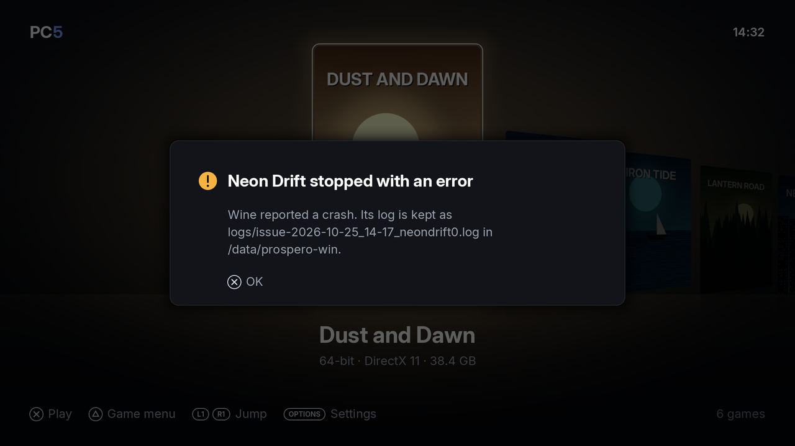

If a game won't start, crashes, or PC5 itself does something wrong, please report it as an issue on GitHub, with the game's log attached. The log is what lets the cause be found. This page explains where to report, what to include, and where to find the log.

## Where to report

Report problems as **GitHub issues**: <https://github.com/bornaradusin/PC5/issues>

Please don't report problems in ProsperoStore comments. Comments can't hold a log file, and they can't be followed up the way an issue can.

## Before you report

1. **Update to the newest PC5** and try again. A log from an older version often shows a problem that is already fixed. See [Updating PC5](Installing-and-updating#updating-pc5).
2. **Check the program.** If the game closes at once, PC5 may have started the wrong `.exe`. See [Choosing the right program](Installing-games#choosing-the-right-program).
3. **Try another controller mode** if the game doesn't react to the controller. See [Controllers](Controllers).
4. **Look at [Troubleshooting](Troubleshooting)** and at the [existing issues](https://github.com/bornaradusin/PC5/issues?q=is%3Aissue): someone may have reported it already.

## What to include

1. **The PC5 version**, from **Settings › About PC5** (press **Options** in the library). For example `1.5.0`.
2. **The game**: its name, and the program PC5 starts for it (shown in the game's menu under **Change program**).
3. **What happened**: what you did, where it stopped, what was on screen, and whether it happens every time.
4. **How the game is set up**, if you changed anything: its controller mode, frame generation, and any [launch options](Launch-options).
5. **The log** of that session, attached as a file (see below).

## Finding the log

PC5 keeps logs in:

```text
/data/prospero-win/logs/
```

While a game runs, its log is written as `session-N.log`. When PC5 next opens, it looks at the sessions that have ended:

- A session that **went wrong** is kept as `issue-<when>_<game>.log`. That means the game crashed, closed within a minute without showing anything, or didn't close when asked and had to be ended.
- A session that went well is deleted, unless **Settings › Keep all logs** is **On**. Then it is kept as `log-<when>_<game>.log`.
- Nothing in `logs/` is kept longer than **seven days**.

`<when>` is the date and time the session began, on the console's clock (`2026-10-25_14-17`), and `<game>` is the game's id (`neon-drift`, for example; `launcher` for PC5's own sessions).

When a session went wrong, PC5 tells you the next time it opens, and names the kept log:


*After a crash, PC5 names the log it kept. Attach that file to your issue.*

| PC5 says | What happened |
| --- | --- |
| *Game* stopped with an error | Wine reported a crash in the game. |
| *Game* closed before showing anything | The game ended within a minute of starting without showing a picture, or Wine couldn't start it. Check the program first. |
| *Game* had to be closed | The game didn't close when asked, so PC5 ended it. |
| PC5 ended unexpectedly last time | PC5 itself stopped while it ran. Its log is `issue-<when>_launcher.log`. |

Attach the newest `issue-…` log for that game. Attach the file itself, not parts of it pasted into the issue.

### Logs in parts

A long session's log is written in parts. How the session began is kept with `-start` added to its name, and the part before the newest with `-earlier`:

```text
issue-2026-10-25_14-17_neon-drift.log
issue-2026-10-25_14-17_neon-drift-earlier.log
issue-2026-10-25_14-17_neon-drift-start.log
```

Attach all of them. A line that repeats many times is saved once, followed by `the line before came N more times`.

### When there is no issue log

- **You started the game from its [home screen tile](Home-screen-tiles).** Leaving the game goes back to the home screen, so PC5 hasn't opened since. Open PC5 once: it files the log then.
- **The game froze, or you had to restart the console**, but it had shown pictures. PC5 may not see a problem in such a log. Open an issue anyway and say what happened and when: you'll be asked for what's needed.
- **An install or uninstall went wrong.** PC5 keeps that session's log as `issue-<when>_launcher.log`, once PC5 has been closed and opened again. It doesn't show a message for it.

### Copying the log off the console

Copy the file from `/data/prospero-win/logs/` with the tool you use to move files to and from the console (an FTP server payload, for example). GitHub accepts `.log` files as attachments: drag the file into the issue's text box. If it is too large to attach, zip it first.

## What a crash log contains

From PC5 1.3.0, when a game crashes its log has a crash report: lines starting with `wine: crash report:`. They give the module and offset the crash happened at (such as `game.exe+0x1a2b3c`), the registers, and the code addresses on the stack. That is what lets the cause be found, so a log from 1.3.0 or newer is the most useful one to attach.

## Opening the issue

1. Go to <https://github.com/bornaradusin/PC5/issues> and choose **New issue**. You need a GitHub account.
2. Give it a title that says what goes wrong, for example "Game closes before showing anything after its intro video".
3. Write the details from [What to include](#what-to-include).
4. Drag the log file (or both parts) into the text box, wait for it to upload, and submit.

Thank you: every report with a log helps more games run.
