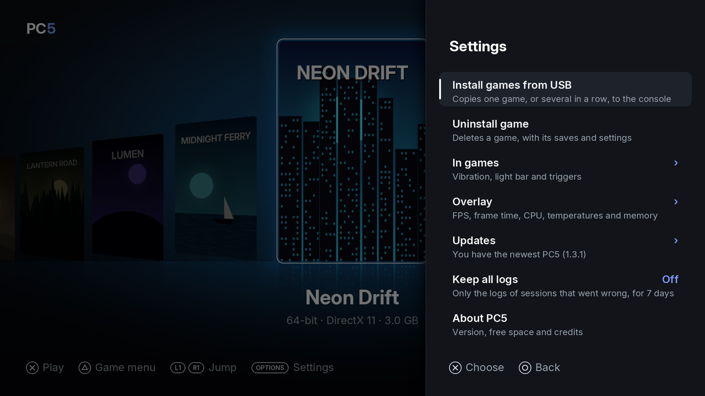
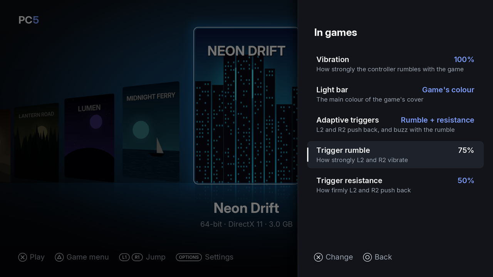
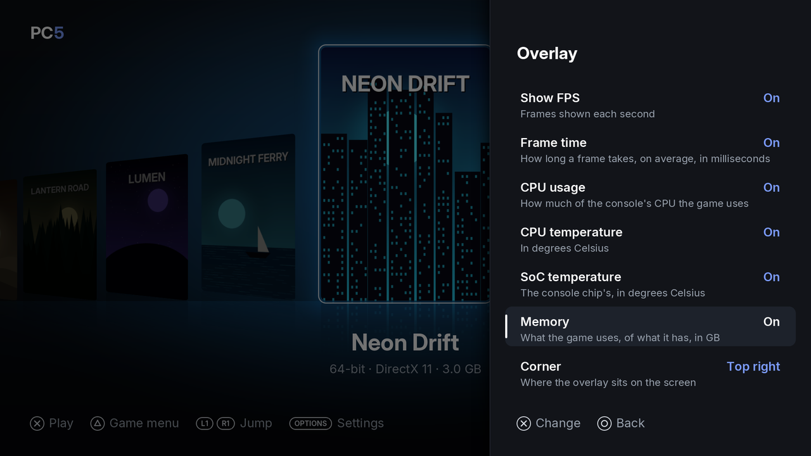

PC5's Settings hold installing and uninstalling games, the settings that apply in every game (the controller's rumble, light bar and triggers, and the overlay), the update check, the logs and the About screen. Settings that belong to one game (its controller, frame generation, program and home screen tile) are in that game's menu instead: see [Playing games](Playing-games#the-game-menu).

## Opening Settings

Press **Options** in the library. Settings opens on the right.

*Settings: its first page. A › means the row opens a page of its own.*

| Button | In Settings |
| --- | --- |
| Up / down | Move between rows |
| ✕ | Open the row, or change its value |
| Left / right | Change the value of a row that has one |
| ○ | Back (from a page, to the first page; from the first page, to the library) |
| Options | Close Settings |

Changes are saved at once, in `/data/prospero-win/pc5/settings.txt`. Settings for games apply from the next time a game starts.

## The first page

| Row | What it does |
| --- | --- |
| Install games from USB | Copies one game, or several in a row, from a USB drive to the console. See [Installing games](Installing-games). |
| Uninstall game | Lists your games to uninstall one, with its saves and settings. See [Uninstalling a game](Installing-games#uninstalling-a-game). |
| In games › | Vibration, light bar and adaptive triggers. See [In games](#in-games). |
| Overlay › | The overlay shown over every game. See [Overlay](#overlay). |
| Updates › | Checking GitHub for a newer PC5. The row shows the last answer. See [Updates](#updates). |
| Keep all logs | **Off** (the default): only the logs of sessions that went wrong are kept. **On**: every session's log is kept. Either way, logs are kept for 7 days. See [Reporting a problem](Reporting-a-problem). |
| About PC5 | The version, where games are kept, the free space on the console, and credits. |

## In games

*Settings › In games, with both trigger effects on. Trigger rumble and Trigger resistance only show while their effect is on.*

| Row | Values | What it does |
| --- | --- | --- |
| Vibration | Off, 25, 50, 75, **100 %** | How strongly the controller rumbles with the game. Off: no rumble. |
| Light bar | **Game's colour**, Follows the screen, Console's colour | Game's colour: the main colour of the game's cover. Follows the screen: the colour of what is on screen, changing with it. Console's colour: PC5 leaves the light bar as the console has it. |
| Adaptive triggers | **Off**, Rumble, Resistance, Rumble + resistance | Rumble: L2 and R2 vibrate with the game's rumble. Resistance: they push back as you press them. Rumble + resistance: they push back, and vibrate instead while the game rumbles (a trigger runs one effect at a time). |
| Trigger rumble | 25, 50, 75, **100 %** | How strongly L2 and R2 vibrate. Shows with Rumble or Rumble + resistance. |
| Trigger resistance | 25, **50**, 75, 100 % | How firmly L2 and R2 push back. Shows with Resistance or Rumble + resistance. |

Defaults are in **bold**.

These follow the settings in every game, whatever its [controller mode](Controllers). With the **DualSense** mode, a game that sets its own light bar or trigger effects gets them instead, from the moment it sets them. When a game ends, PC5 gives the controller back as the console had it.

## Overlay

The overlay is a small box over every game, updated every second. Each line can be turned on or off.

*Settings › Overlay, with every line turned on.*

| Row | Shows |
| --- | --- |
| Show FPS | Frames shown each second. On its own, it is a large counter. |
| Frame time | How long a frame takes, on average, in milliseconds |
| CPU usage | How much of the console's CPU the game uses |
| CPU temperature | The CPU's temperature, in degrees Celsius |
| SoC temperature | The console chip's temperature, in degrees Celsius |
| Memory | The memory the game uses, of what it has, in GB |
| Corner | Where the overlay sits: Top left, **Top right**, Bottom left or Bottom right |

All lines are **Off** by default. A line the console can't read is left out. With [frame generation](Playing-games#frame-generation) on, the FPS counts every frame shown, the made ones too.

## Updates

| Row | What it does |
| --- | --- |
| Check when PC5 opens | **On** (the default): PC5 asks GitHub for a newer release when it opens, at most once an hour. Off: only when you ask. |
| Check now | Asks GitHub straight away. The answer shows under the row. |

When a newer PC5 is out, the console shows a notification once for that release, and the Updates page says where to get it. PC5 never updates itself. See [Updating PC5](Installing-and-updating#updating-pc5).

## About PC5

Shows the PC5 version and title ID (`PPSA11018`), what PC5 runs games with, where games are kept (`/data/prospero-win`) and the free space on the console. Press **○** to close it.

*About PC5. Give this version when you report a problem.*
